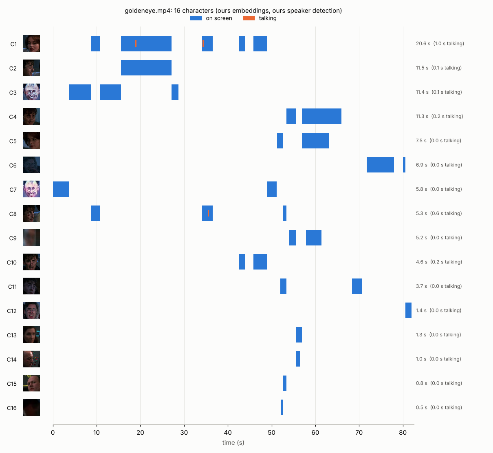
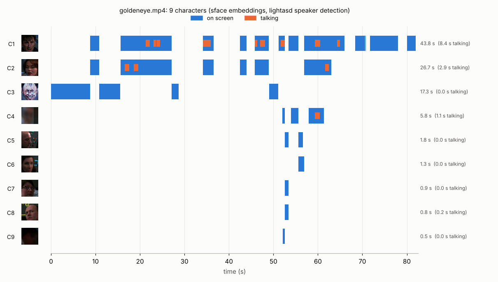

# Phase 3 — Character timeline and who's talking (Weeks 9–11)

**Feature:** for any clip, CineScope finds the characters (faces tracked within
shots, then grouped into people across shots), marks when each is on screen,
and marks when each is talking.

```bash
python p3_tracking/timeline.py trailers/goldeneye.mp4                      # our embedder + our speaker score
python p3_tracking/timeline.py trailers/goldeneye.mp4 --embedder sface --asd lightasd
python p3_tracking/timeline.py clip.mp4 --detector centernet --det-ckpt p2_detection/checkpoints/centernet_r18.pt
# -> outputs/<clip>/characters.json, outputs/<clip>/timeline.png
```

Default (everything from scratch: our embedder, our speaker score):



The same clip with the library models (`--embedder sface --asd lightasd`):



The difference is the Week 10 and 11 results in one picture: our embedder
splits Boris and Natalya into several characters each (16 found, 8 people
labelled), SFace finds 9; our speaker score marks a few tenths of a second
of talking where Light-ASD marks Boris's and Natalya's lines.

`characters.json` holds, per character: its tracks, screen time, talking
time, on-screen and talking intervals in seconds; per track: frames, boxes,
the character it was assigned to and a per-frame speaking score. Weights are
read from `data/weights` (override with `CINESCOPE_WEIGHTS`): `yunet.onnx`,
`sface.onnx`, `light_asd_ava.model`.

Every step is cached in `outputs/<clip>/`, so a rerun with a different
embedder or speaker model only redoes that step. A goldeneye run (2 min, 1080p, 2 CPU
threads) took 103 s with SFace and our speaker score; Light-ASD
adds ≈ 13 min.

## Week 9 — tracking

| Built | Module | Checked against |
|---|---|---|
| Hungarian algorithm (shortest augmenting path with dual potentials, rectangular, forbidden pairs) | `cinescope/track/hungarian.py` | `scipy.optimize.linear_sum_assignment`: same optimum on 300 random matrices, incl. rectangular and `inf` |
| Kalman filter for boxes (x, y, aspect, height + velocities; noise scaled by height; Mahalanobis gating) | `cinescope/track/kalman.py` | learns a constant velocity; uncertainty grows while unobserved |
| ByteTrack-style tracker (two-round association: high-score then low-score detections; tentative tracks; reset at Phase 0 shot cuts) | `cinescope/track/tracker.py` | ultralytics `BYTETracker` / `BOTSORT` (`cinescope/track/ultra.py`) |
| CLEAR-MOT (MOTA, MOTP, IDSW) and IDF1 (global bipartite id matching), with ignore regions | `cinescope/track/mot.py` | `motmetrics`: identical counts and scores on random sequences |
| Synthetic sequences with exact ground truth (misses, occlusion, low-score dips, false positives, cuts) | `cinescope/track/synthetic.py` | — |
| Pluggable face detectors: OpenCV YuNet, or the Phase 2 CenterNet | `cinescope/faces/detectors.py` | — |

```bash
python p3_tracking/track_clip.py trailers/goldeneye.mp4 [--tracker ours|bytetrack|botsort] [--detector centernet --ckpt ...]
python p3_tracking/eval_mot.py --clips trailers/goldeneye.mp4 trailers/head-pose-face-detection-female-and-male.mp4 trailers/face-demographics-walking.mp4
python p3_tracking/eval_mot.py --synthetic 200
```

Results (`results/mot.json`). Clips: hand-labelled frames only (see
`labels/README.md`); every tracker gets the same YuNet detections; a
ground-truth object is "one person within one shot".

| Tracker | goldeneye MOTA / IDF1 | head-pose MOTA / IDF1 | walking MOTA / IDF1 | synthetic ×200 MOTA / IDF1 | ms/frame |
|---|---|---|---|---|---|
| **ours** (ByteTrack-style, cuts reset) | 0.978 / 0.989 | 1.000 / 1.000 | 0.976 / 0.988 | 0.803 / 0.865 | 0.5–1.1 |
| ours without the low-score round (SORT-like) | 0.978 / 0.989 | 0.986 / 0.794 | 0.976 / 0.988 | 0.697 / 0.796 | 0.4–0.9 |
| ours, no reset at cuts | 0.978 / 0.984 | 1.000 / 1.000 | 0.976 / 0.988 | 0.802 / 0.861 | |
| ultralytics ByteTrack (defaults) | 0.892 / 0.943 | 1.000 / 1.000 | 1.000 / 1.000 | 0.821 / 0.878 | 0.5–1.1 |
| ultralytics ByteTrack, our thresholds | 0.978 / 0.989 | 1.000 / 1.000 | 0.927 / 0.962 | 0.783 / 0.855 | |
| ultralytics BoT-SORT (no camera-motion comp., no ReID) | 0.892 / 0.943 | 1.000 / 1.000 | 1.000 / 1.000 | 0.821 / 0.878 | |

What the numbers say:

- **The clips are easy for association**; the differences are a handful of
  boxes (goldeneye: 202 labelled boxes, ultralytics' defaults start tracks on
  16 more low-score boxes, ours misses 3). Synthetic sequences, with exact
  ground truth and deliberately nasty detections, are where trackers
  separate: the low-score round is worth +0.11 MOTA, and ultralytics is 0.02
  ahead of ours (its defaults start tracks more eagerly and keep them longer,
  which pays on the synthetic sequences and costs on goldeneye).
- **Our thresholds were set a priori** (ByteTrack paper values: high 0.6,
  low 0.3, new track 0.7), not tuned on any of these.
- **Cut resets** barely move the scores here because a ground-truth object is
  per shot anyway; their job is to stop the Kalman filter from gating a new
  shot's face to the previous shot's track, which the clustering stage then
  could not undo (one track would carry two people).
- **The ground-truth boxes are YuNet's own** (labels assign identities to
  YuNet proposals), so these scores measure association, not detection.

The Phase 2 CenterNet plugs in with `--detector centernet --ckpt`. No trained
checkpoint was available on this machine (only a 2-epoch synthetic smoke
model, which finds no faces in real frames, at 2–3 s/frame on CPU), so every
number here is with YuNet.

## Week 10 — who is who (metric learning, self-supervised)

| Built | Module | Compared with |
|---|---|---|
| Face alignment: Umeyama similarity to the ArcFace 112×112 five-point template | `cinescope/faces/align.py` | recovers a known similarity; OpenCV `estimateAffinePartial2D` |
| Embedding net from scratch (small ResNet, 64 px input, 128-d, L2-normalised) | `cinescope/faces/embed.py` | OpenCV-zoo SFace (MobileFaceNet-style, trained on millions of labelled faces) |
| Self-supervised batch-hard triplet loss: positives = same track; negatives only where *known* (two tracks in the same frame, or tracks from different clips) | `cinescope/faces/embed.py` | ArcFace loss on track ids (the naive "every track is a class" baseline) |
| Agglomerative clustering (average linkage, Lance–Williams) with cannot-link constraints; label-free threshold | `cinescope/faces/cluster.py` | `scipy.cluster.hierarchy` average linkage (same partitions); `oracle_k` diagnostic |
| Purity, inverse purity, pairwise precision/recall/F1 | `cinescope/faces/cluster.py` | hand-worked cases |

```bash
python p3_tracking/train_embed.py trailers/Megamind.avi trailers/classroom.mp4 trailers/one-by-one-person-detection.mp4 \
    data/clips/worker-zone-detection.mp4 data/clips/store-aisle-detection.mp4 --steps 400 [--loss arcface]
python p3_tracking/eval_cluster.py trailers/goldeneye.mp4 trailers/head-pose-face-detection-female-and-male.mp4 trailers/face-demographics-walking.mp4
```

`data/clips/` (training only, never in the repo) are Intel's public sample
videos:

```bash
for c in worker-zone-detection store-aisle-detection; do
  curl -L -o data/clips/$c.mp4 https://raw.githubusercontent.com/intel-iot-devkit/sample-videos/master/$c.mp4; done
```

The three scored clips are never trained on (`train_embed.py` refuses them).

**Why the negatives must be "known".** Without identity labels, two
different tracks may well be the same person (one actor across shots).
Treating every other track as a negative — which is what ArcFace on track ids
does — pushes apart exactly the pairs clustering must later merge. Two tracks
visible in the same frame are certainly two people, and so are tracks from
different videos; the triplet loss uses only those.

**The threshold, without labels.** Each clip supplies its own known-same
pairs (the two halves of a track) and known-different pairs (co-occurring
tracks); the threshold minimises miss rate + false-alarm rate between them.
Halves of a track are easier than one person across shots, so this leans
towards too many clusters (higher purity, lower inverse purity). When a
clip has no co-occurring tracks the threshold falls back to 0.5 (SFace) /
0.3 (ours), fixed before any test clip was scored.

Two protocols: **tracks** (the tracker's tracks as they are) and
**tracklets** (every track cut into 2 s pieces). head-pose and walking have
one unbroken track per person, which makes the tracks protocol trivial;
tracklets make the embedding link one person across pose and distance, as a
film's shots would.

Results (`results/cluster.json`). Purity / inverse purity / pairwise F1;
clusters found vs. true identities. Tracks without a labelled frame, or
labelled `ignore`, are clustered but not scored.

| Clip, protocol | ours (triplet) | ours (ArcFace on track ids) | SFace |
|---|---|---|---|
| goldeneye, tracks (28 scored) | 0.93 / 0.54 / 0.32 — 15 vs 8 | 1.00 / 0.61 / 0.48 — 13 vs 8 | **1.00 / 1.00 / 1.00 — 8 vs 8** |
| goldeneye, tracklets (56) | 0.95 / 0.52 / 0.38 — 18 vs 8 | 1.00 / 0.54 / 0.47 — 18 vs 8 | **1.00 / 0.98 / 0.97 — 9 vs 8** |
| head-pose, tracks (2) | 1.00 / 1.00 / 1.00 — 2 vs 2 | 1.00 / 1.00 / 1.00 — 2 vs 2 | 1.00 / 1.00 / 1.00 — 2 vs 2 |
| head-pose, tracklets (144) | 1.00 / 0.66 / 0.61 — 29 vs 2 | 1.00 / 0.65 / 0.61 — 29 vs 2 | **1.00 / 0.76 / 0.74 — 18 vs 2** |
| walking, tracks (7) | 0.57 / 1.00 / 0.00 — 4 vs 7 | 0.43 / 1.00 / 0.00 — 3 vs 7 | **1.00 / 1.00 / 1.00 — 7 vs 7** |
| walking, tracklets (22) | 0.50 / 0.55 / 0.19 — 7 vs 7 | 0.45 / 0.86 / 0.36 — 4 vs 7 | **1.00 / 1.00 / 1.00 — 7 vs 7** |

Our net: 400 steps (≈ 16 min for triplet, 9 min for ArcFace, 2 threads on a
shared CPU) on 1305 crops of the 23 usable tracks from five clips
(Megamind, classroom, one-by-one-person-detection, worker-zone, store-aisle;
tracks shorter than 8 frames or with faces under 32 px dropped). The
driver-action-recognition clip was meant as a sixth, but detecting its
12,552 1080p frames did not finish within the time limit on the shared
machine, and people-detection has no detectable faces.

What the numbers say:

- **SFace wins everywhere, by a wide margin** — expected: it was trained on
  hundreds of thousands of labelled images of thousands of identities; ours saw 23 tracks, of which
  only 10 have a co-occurring partner (the hard negatives). The triplet loss
  reached zero by step 300 (`results/embed_triplet_history.csv`): with so
  few known negatives the net separates the training tracks easily and
  learns little that transfers. ours is not useless — on goldeneye it keeps
  clusters pure (0.93–1.00) — but it splits each person into about two
  clusters, and on walking (people seen small and from a distance) it merges
  different people.
- **Self-supervised triplet vs. ArcFace-on-track-ids.** On this little data
  the expected advantage of the triplet loss (no false negatives between two
  tracks of one person) does not show; ArcFace is equal or better on 4 of 6
  rows. With 23 tracks from five clips there are few same-person track pairs
  to wrongly push apart, so the argument has nothing to act on; it needs a
  film's worth of shots.
- **The label-free threshold leans to over-splitting**, as designed (the
  halves of one track are easier than one person across shots): purity stays
  at 1.00 for SFace on all clips while head-pose tracklets fall into 18
  clusters. The `oracle_k` diagnostic in `cluster.json` (same tree, cut at
  the true number of people) shows the trade-off the other way: on goldeneye
  it forces the five technicians — each seen for a second — into fewer
  clusters and drops SFace's purity to 0.79.
- head-pose and walking are easy on the tracks protocol (one unbroken track
  per person) — read the tracklets rows.

Thresholds: chosen per clip by the rule above, with no labels; training
never saw the three scored clips. One change was made after a first look at
test output, and is disclosed here: for tracklets, the known-same pairs now
come from the halves of the whole tracks the tracklets were cut from. In
the first SFace run 2-second tracklets had too few colour crops to halve,
the rule had no pairs and fell back to 0.5 (head-pose tracklets then scored
1.00 / 0.87 / 0.86 with 8 clusters — better than the rule, by luck of the
fallback value). The fix was made for the method's sake (the timeline uses
whole tracks too), not tuned to a number, and the rule's numbers are the ones
reported.

## Week 11 — who is talking

| Built | Module | Compared with |
|---|---|---|
| Audio loading (PyAV, 16 kHz mono), MFCC | `cinescope/speaker/audio.py` | `python_speech_features.mfcc` (equal to 1e-12) |
| Voice activity: speech-band energy × syllable-rate (3–8 Hz) modulation × voicing (spectral flatness) | `cinescope/speaker/audio.py` | Silero VAD (agreement reported below) |
| Mouth motion on aligned faces, normalised by upper-face motion (head movement and cuts move both) | `cinescope/speaker/active.py` | — |
| Audio–visual synchrony: windowed correlation of mouth motion and audio envelope, ±2 frames lag | `cinescope/speaker/active.py` | — |
| Speaking score = speech × mouth-activity × (½ + ½·sync), mouth z-scored on the clip's non-speech frames | `cinescope/speaker/active.py` | Light-ASD (Liao et al., CVPR 2023), trained on AVA-ActiveSpeaker, vendored (MIT) in `cinescope/speaker/lightasd.py` |
| AP (tie-aware), ROC-AUC, F1 at a fixed threshold | `cinescope/speaker/metrics.py` | `sklearn.metrics` |

```bash
python p3_tracking/eval_asd.py trailers/goldeneye.mp4
```

goldeneye, 1910 labelled face-frames, 194 speaking (`results/asd.json`;
labels in `labels/goldeneye.speech.json`). Thresholds were fixed before
scoring (ours 0.25, Light-ASD logit 0) and this is the first and only run.

| System | AP | ROC-AUC | F1 @ fixed threshold | time |
|---|---|---|---|---|
| **ours** (VAD × mouth × sync) | 0.391 | 0.836 | 0.221 (P 0.63, R 0.13) | 1.4 s |
| ours without synchrony | 0.388 | 0.838 | | |
| ours, audio VAD only | 0.343 | 0.810 | | |
| ours, mouth motion only | 0.235 | 0.662 | | |
| ours, synchrony only | 0.111 | 0.547 | | |
| ours with Silero VAD as the audio cue ¹ | 0.538 | 0.896 | | |
| **Light-ASD** (AVA weights) | **0.915** | **0.976** | **0.894** (P 0.92, R 0.87) | 816 s |

¹ favoured by construction: Silero decided audibility while labelling.

What it teaches:

- **The hand-built score is weak, and the ablation says where.** Audio alone
  gets most of it (0.34 of 0.39 AP): in a trailer whoever is on screen while
  someone talks is a good guess. Mouth motion adds a little; synchrony adds
  nothing measurable. Trailer audio is dialogue under music and effects, and
  at 24 fps with ±0.25 s label edges a hand-made correlation has little to
  grab.
- **The VAD is the weakest link.** It agrees with Silero on 75% of frames but
  hears only half of Silero's speech (music masks the energy cue); a steady
  tone passes it (spectral flatness alone is fooled — kept as a documented
  test case rather than re-tuned after the test run). Swapping in Silero
  lifts AP from 0.39 to 0.54, partly for the reason in ¹.
- **Light-ASD is far ahead** (AP 0.92) because it learnt lip–audio
  correspondence end-to-end from 3.6 M AVA face-frames — but it costs ~600×
  more CPU time. The fixed threshold of 0.25 for ours is also too strict
  (recall 0.13); it was chosen a priori and is reported as such.
- Only goldeneye has dialogue: head-pose and walking have silent audio tracks.

## Engineering note — memory that grows by one frame per frame

Detection over a 1080p clip grew to 4.4 GB and was OOM-killed although the
code keeps only small arrays. Cause: glibc raises its mmap threshold after
the first large frees, so every decoded frame (2–6 MB) then lands on the
heap; small kept arrays get placed between them and the heap can never
shrink. `cinescope.faces.clip.mmap_large_buffers()` pins
`M_MMAP_THRESHOLD` at 128 KB; memory now stays flat at ≈ 230 MB.

## Labels and rules

- All labels are in `labels/` with how they were made (by eye, on contact
  sheets; no system output shown) — see `labels/README.md`.
- Nothing was tuned on the three scored clips; training clips are disjoint.

Optional packages (tests skip without them): `pip install motmetrics lap
python_speech_features silero-vad` (`lap` is needed by ultralytics' trackers).

## Interview questions

**ByteTrack vs. SORT — what does the second round buy?** SORT drops
detections under the score threshold. A face turning away, blurred or
half-occluded often scores 0.3–0.5 for a few frames; dropping it ends the
track and starts a new id later. ByteTrack matches those low-score boxes,
but only to tracks that already exist (they are not allowed to start
tracks), so it recovers occluded objects without letting background noise
in. Here: +0.11 MOTA and +0.07 IDF1 on synthetic sequences.

**MOTA vs. IDF1?** MOTA counts per-frame errors (misses, false positives,
id switches) and is dominated by detection quality; an id switch costs one
error however long the wrong id persists. IDF1 matches whole trajectories
to whole ground-truth tracks once, globally, and scores the fraction of
frames with the right id — it measures how long identities are kept.

**Why the Hungarian algorithm and not greedy matching?** Greedy takes the best
pair first and can force a worse total (two tracks competing for one box).
Hungarian gives the minimum-cost one-to-one assignment in O(n³); with a
handful of faces per frame both are instant, so correctness wins.

**Triplet vs. ArcFace?** ArcFace needs a fixed set of classes with reliable
labels and gives very discriminative embeddings when it has them. Triplet
(or contrastive) losses only need pairwise relations, which suits
self-supervision: "same track" and "same frame, different track" are pair
facts, not class labels.

**How do you pick the number of characters?** You don't: agglomerative
clustering with a distance threshold, the threshold read off pairs the clip
itself proves same/different, plus cannot-links for faces in one frame.

**How would you make the speaker detector better without labels?**
Self-supervise synchrony (Chung & Zisserman's SyncNet): real audio–video
pairs vs. pairs shifted in time, learned on any talking footage; then use
the learned sync score in place of the hand-made correlation.
