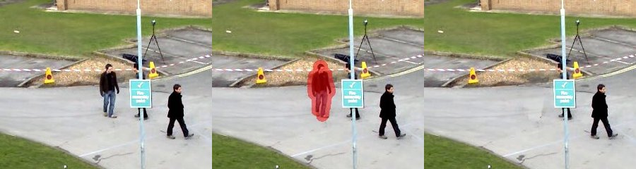
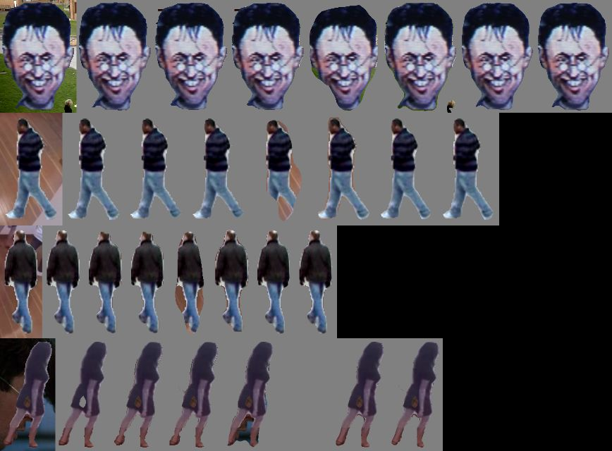
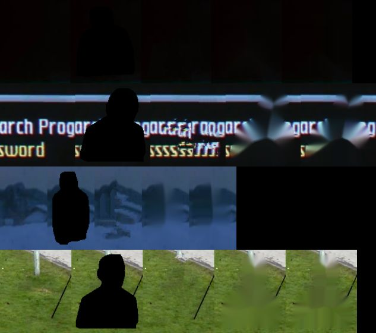

# Phase 4 — Segmentation, matting, inpainting (Weeks 12–13)

**Feature:** CineScope cuts an actor out of a frame (an RGBA PNG with soft
edges) and removes a person from a stretch of a clip, filling the hole with the
background other frames saw. Every core algorithm is built here first —
max-flow, GrabCut, a U-Net, closed-form matting, exemplar inpainting, temporal
background reconstruction — then scored against SAM 2, MobileSAM, cv2.grabCut,
pymatting and cv2.inpaint.

```bash
python p4_segmentation/cutout.py trailers/goldeneye.mp4 --t 12.5                       # largest person, our GrabCut + matting
python p4_segmentation/cutout.py trailers/goldeneye.mp4 --t 12.5 --box 289 155 423 361 --method sam2
# -> outputs/goldeneye/cutout_12.51.png (RGBA) + _preview.jpg
python p4_segmentation/remove.py trailers/vtest.avi --start 10 --end 13 --context 8 --dilate 6
# -> outputs/vtest/removed_10_13.mp4 (+ .jpg before / mask / after, .json report)
```

Weights are local files (`data/weights/`, or set `CINESCOPE_WEIGHTS`):
`yolov8n-seg.pt` (person boxes for auto mode and tracking), `sam2_t.pt` and
`mobile_sam.pt` (comparison, `--method sam2|mobilesam`). The U-Net is trained
here (`--method unet`, below). `pip install pymatting` adds the matting
comparison rows (optional).



*vtest.avi, 10–13 s: input, tracked mask (GrabCut on YOLOv8n-seg boxes, dilated 6 px), output.*

## Week 12 — segmentation

| Built | Module | Checked against |
|---|---|---|
| Boykov–Kolmogorov max-flow / min-cut (two search trees, orphan adoption, timestamps) | `cinescope/segment/maxflow.py` | `scipy.sparse.csgraph.maximum_flow` on 150 random graphs (same flow; cut capacity = flow); hand example; MRF denoising |
| Full-covariance GMM colour models, GrabCut-style hard re-assignment | `cinescope/segment/gmm.py` | `scipy.stats.multivariate_normal` log-density |
| SLIC superpixels, vectorised (9 neighbouring grid centres per pixel), connectivity enforcement | `cinescope/segment/superpixels.py` | every region connected; region count |
| GrabCut: superpixel graph cut, then a pixel band re-cut, same energy | `cinescope/segment/grabcut.py` | `cv2.grabCut` on the same crop (test + benchmark) |
| Box-prompted U-Net (1.96 M params, 96×96 box crops), BCE + Dice | `cinescope/segment/unet.py`, `train_unet.py` | SAM 2 / MobileSAM / YOLOv8n-seg (benchmark) |
| Composites with exact masks, distilled people sets | `cinescope/segment/data.py`, `make_people.py` | |

**Graph cuts for segmentation.** GrabCut minimises
E = Σ data cost + γ Σ exp(−β|c_p − c_q|²)/dist · [labels differ]. Source = foreground,
sink = background; terminal edges carry the data costs (negative GMM
log-likelihoods), neighbour edges the contrast-weighted smoothness. Any s–t cut
is a labelling and its capacity is its energy, so the min cut is the global
optimum of E for fixed GMMs; GrabCut alternates "fit GMMs" and "cut".

**Making it fast enough in pure Python.** BK in Python lists runs ~10⁴–10⁵
node graphs in seconds, so the cut runs twice over the *same* energy: first on
SLIC superpixels (split along the box edge; a region's unary is the sum of its
pixels', an edge the sum of pixel pairs crossing it — the pixel energy
restricted to labellings constant per region), then on a 3-pixel band around
that boundary, with the pixels outside the band fixed and their pull turned
into terminal capacities. ~0.6 s per box vs. 1.5 s for the first version.

**Settings were picked on training clips only** (`tune_grabcut.py`, 40
composites of training-clip people over training-clip frames): margin 0.25,
γ = 50, 60 px per superpixel, dev mIoU 0.958 (`results/grabcut_dev.json`).

**A collapse bug, found by a unit test.** On small crops with coarse
superpixels, the regions straddling the object boundary are labelled
background after the first cut. They teach the background GMM the object's
colours, the foreground shrinks every round (20 → 17 → 15 → 0 regions on the
synthetic test scene), and GrabCut returned an empty mask. Two fixes: a cut
that empties the foreground is rejected (the last non-empty labelling is
kept), and a crop always gets at least 200 superpixels. On the dev set the
guard lifted the γ = 100 settings by 0.02 and left the chosen setting
unchanged. The 200 floor ties with no floor on every dev setting: dev
people are big enough to get more than 200 regions anyway. It is a
robustness floor for small people, not a tuned number.

### Training the U-Net without labels

There are no person masks for our footage, so the targets are explicit:

- **distilled** (half the samples): real training frames, a YOLOv8n-seg person
  box (edges jittered by 4% of the box size) and YOLOv8n-seg's own mask as
  target. Real boundaries and occlusions, but the student inherits the teacher's
  coarse 160×160-prototype edges.
- **synthetic composites** (other half): a YOLOv8n-seg cut-out from one
  training frame pasted at random scale/place onto another training (or
  `testvideo.mp4` / `fades.mp4`) frame. The pasted mask is exact by
  construction; the seams are unnaturally sharp.

Training clips: `classroom.mp4`, `face-demographics-walking.mp4`,
`one-by-one-person-detection.mp4`, `head-pose-face-detection-female-and-male.mp4`
(a frame every 1.5 s; 357 people). Test clips, never used for training or for
choosing anything: `goldeneye.mp4`, `vtest.avi`, `people-detection.mp4`.

```bash
python p4_segmentation/make_people.py --role train --every 1.5 trailers/classroom.mp4 trailers/face-demographics-walking.mp4 \
    trailers/one-by-one-person-detection.mp4 trailers/head-pose-face-detection-female-and-male.mp4
python p4_segmentation/make_people.py --role trainbg --keep-empty --every 2 trailers/testvideo.mp4 trailers/fades.mp4
python p4_segmentation/train_unet.py --steps 1500          # 26 min on one CPU thread
```

1,500 steps × 16 crops, AdamW + one-cycle (3e-3): dev IoU (fixed-seed
composites + distilled crops of the training clips) 0.908 → 0.939 → 0.961 →
0.969 at steps 250 / 500 / 1000 / 1500 (`results/unet_train.json`).

### Results — mask IoU / speed vs. SAM 2

```bash
python p4_segmentation/make_people.py --role test --every 4 trailers/goldeneye.mp4 trailers/vtest.avi trailers/people-detection.mp4
python p4_segmentation/bench_segment.py
```

<!-- auto:p4-segment -->
Two scores, both from `results/segment.json` (one CPU thread):

- **vs. SAM 2**: 37 test frames, 101 prompts (every confident, whole
  YOLOv8n-seg person box). SAM 2 tiny's mask is the reference, so this is
  *agreement* with a strong model on real footage, not accuracy. SAM 2 is 1.0
  by definition.
- **exact truth**: 60 composites. A test person (pixels where SAM 2 *and*
  YOLOv8n-seg say person) is pasted onto a frame of a *different* test clip at
  25–80% of its height. The pasted mask is exact, the prompt is its tight box,
  and every method, SAM 2 included, is scored.

| Method | mIoU vs. SAM 2 (real) | ms / frame (real, 2.7 prompts) | mIoU exact (composites) | median | IoU < 0.5 | ms / composite |
|---|---|---|---|---|---|---|
| GrabCut (ours: SLIC + band cut, own BK max-flow) | 0.732 | 589 | 0.914 | 0.955 | 2 | 215 |
| U-Net (ours, 1.96 M params, CPU-trained) | 0.709 | 91 | 0.756 | 0.772 | 1 | 34 |
| cv2.grabCut | 0.754 | 212 | 0.950 | 0.957 | 0 | 72 |
| YOLOv8n-seg (not promptable: best-matching mask) | 0.875 | 195 | 0.778 | 0.917 | 9 | 154 |
| MobileSAM | 0.920 | 3,835 | 0.964 | 0.968 | 0 | 4,590 |
| SAM 2 tiny | 1.000 (reference) | 6,011 | **0.971** | 0.976 | 0 | 8,919 |

Per clip, vs. SAM 2 (goldeneye / vtest / people-detection): GrabCut (ours)
0.62 / 0.76 / 0.70, U-Net 0.70 / 0.71 / 0.68, cv2.grabCut 0.61 / 0.79 / 0.69.

The GrabCut row was re-measured after the collapse fix (`bench_segment.py
--methods "GrabCut (ours)"`, which reruns SAM 2 as the reference and leaves
the other rows alone). Before the fix it scored 0.679 vs. SAM 2 (vtest 0.70)
and 0.909 exact, with 3 failures. The fix helped most on vtest's small
people, as expected. The rerun was on a differently loaded machine, so
compare its ms with the other rows loosely. The example picture is from the
first run.
<!-- /auto:p4-segment -->



*Composite crops: input, truth, then each method's mask (columns in the order of the table).*

**What this says.**

- **SAM 2 is the most accurate and the slowest.** It scores 0.971 against
  exact truth and needs 6–9 s per frame on one CPU thread. Most of that is the
  Hiera image encoder, paid once per frame. MobileSAM is within 0.01 at about
  60% of the time. Caveat: each composite's truth mask is the intersection of
  SAM 2's and YOLOv8n-seg's masks on the source frame, so its edges follow SAM
  2's boundary. That favours SAM 2 and MobileSAM slightly.
- **Our GrabCut is a good cutter but disagrees with SAM 2 on real frames.**
  On composites, where the person stands on an unrelated background, colour
  models separate cleanly: median IoU 0.955, as good as cv2.grabCut's 0.957.
  Its mean, 0.914 vs. 0.950, is pulled down by 2 failures where the pasted
  person shares colours with the new background. On real frames it drops to
  0.73 agreement with SAM 2: crowded vtest boxes contain parts of other people,
  and goldeneye's dark suits sit on dark sets. A colour model cannot tell those
  apart. cv2.grabCut (5 iterations at full pixel resolution) is more robust
  there and ~2.8× faster, because it is C++.
- **Our U-Net is the fastest promptable method (34 ms, ~260× faster than SAM
  2) and the least accurate on exact truth (0.756).** Its training targets
  were YOLOv8n-seg masks and composites of four training clips. It reaches
  0.969 IoU on held-out crops of those clips and only ~0.71–0.76 on the
  unseen test clips. 357 people from four clips is too little variety, and
  96×96 crops lose the outline of anything thin. It does copy its teacher's
  habits: its agreement with SAM 2 (0.709) is close to its exact score.
- **YOLOv8n-seg is the odd one.** It agrees well with SAM 2 on real frames
  (0.875; the prompts were its own boxes there) but drops to 0.778 on
  composites. In 9 composites it detected nothing that matched the box (empty
  mask, last row of the picture), mostly small pasted people-detection
  figures (0.42 on those). A detector cannot be told "this box", so it suits
  automatic cut-outs and is unreliable for an editor's prompt.
- **For `cutout.py` the default is our GrabCut plus closed-form matting.** It
  needs no weights beyond a box. `--method sam2` is the accurate option when
  a few seconds per frame are acceptable.

## Week 13 — matting and removal

| Built | Module | Checked against |
|---|---|---|
| Matting Laplacian (3×3 windows, ε = 1e-7), constrained solve by CG | `cinescope/segment/matting.py` | `pymatting.cf_laplacian` (≤1e-5 relative); `pymatting.estimate_alpha_cf` (same SAD to 3 decimals) |
| Trimap from a mask (erode / dilate by 3% of the height) | `matting.py` | |
| Blur-fusion foreground colours (Forte & Pitié 2021) | `matting.py` | `pymatting.estimate_foreground_ml` |
| Criminisi exemplar inpainting (confidence × isophote priority, masked-SSD patch search) | `cinescope/segment/inpaint.py` | `cv2.inpaint` Telea / Navier–Stokes |
| PSNR, SSIM (Gaussian 11-tap, luma) | `inpaint.py` | identities; ordering under noise |
| Track → mask → temporal median plate (other people excluded) → spatial fallback → feathered composite; static-camera check by phase correlation | `cinescope/segment/video_remove.py`, `remove.py` | per-frame Telea / NS / Criminisi on synthetic walkers with known truth |

### Matting on composites with known alpha

`bench_matting.py`: 40 test people. The alpha is a soft matte made from the
person's mask (Gaussian edge, σ 0.7–2 px, plus anti-aliased hair strands drawn
at 4×); F is the person's colours extended outward, B a frame of another test
clip; I = αF + (1−α)B. Every method gets the same trimap, made from α > 0.5
exactly as `cutout.py` makes it. SAD (Σ|error|/1000) and MSE over the unknown
band (~5,500 px per case).

| Alpha | realistic SAD | realistic MSE | clean SAD | clean MSE | ms / case |
|---|---|---|---|---|---|
| binary mask | 0.430 | 0.0373 | 0.430 | 0.0373 | 0 |
| feathered mask (Gaussian 1.5 px) | 0.161 | 0.0080 | 0.161 | 0.0080 | 0 |
| closed-form (ours) | 0.308 | 0.0210 | 0.165 | 0.0041 | 292 |
| pymatting closed-form | 0.308 | 0.0210 | 0.165 | 0.0041 | 94 |
| pymatting KNN | 0.488 | 0.0338 | 0.326 | 0.0124 | 816 |
| pymatting LKM | 0.545 | 0.0689 | 0.342 | 0.0186 | 394 |

| Foreground colours (true alpha given) | realistic MSE | clean MSE | ms |
|---|---|---|---|
| blur-fusion (ours) | 0.0227 | 0.0026 | 12 |
| image as F (no estimation) | 0.0252 | 0.0126 | — |
| pymatting ML (multi-level) | 0.0100 | 0.0011 | 9 |

**What this says.** On the *clean* set (F extended from 6 px inside the mask,
so the only colour change in the band is the alpha change — the colour-line
model holds) closed-form matting halves the MSE of a feathered mask and is
~9× better than the hard mask; it matches pymatting's closed-form to the third
decimal (pymatting is ~3× faster: numba and an incomplete-Cholesky
preconditioner vs. our Jacobi-preconditioned CG). On the *realistic* set the
pasted F still has the source frame's own edges inside the band (YOLOv8n-seg
masks are a few pixels off the true person boundary), and matting follows
those image edges instead of the synthetic alpha — so it loses to plain
feathering there. That is the honest limit of closed-form matting from an
automatic mask: it trusts colour edges, and a sloppy trimap puts the wrong
edges in the unknown band. KNN and LKM matting are worse than closed-form on
both. For foreground colours, pymatting's multi-level solver beats our
one-correction blur-fusion (MSE 0.0011 vs. 0.0026 clean).

### Inpainting single frames

`bench_inpaint.py`: 30 test frames, each with a person-shaped hole (a
*training*-clip person's mask, 15–30% of the frame height, dilated 3 px)
whose original pixels are the truth.

| Method | PSNR in hole (dB) | SSIM (hole box) | ms / frame |
|---|---|---|---|
| Criminisi (ours) | 22.95 | 0.781 | 14,535 |
| cv2 Telea | 23.98 | 0.841 | 44 |
| cv2 Navier-Stokes | 24.56 | 0.844 | 41 |

Criminisi has the higher PSNR on 10 of 30 frames.



*Original, hole, Criminisi (ours), Telea, Navier–Stokes.*

Criminisi loses on PSNR and SSIM and wins in the pictures: it continues the
on-screen text and the grass texture, where diffusion leaves a smooth blur.
Squared-error metrics reward the blur — the mean of plausible fills — and
punish a sharp patch that is plausible but not *the* truth. That is the known
argument for perceptual metrics (LPIPS) in inpainting papers. It is also
300× slower in Python.

### Video object removal with known truth

`bench_removal.py`: a training-clip person (17% of the frame tall) is pasted
into vtest.avi 30–42 s (120 frames) and walks across it; the untouched clip is
the truth. *Fast walker*: crosses ~430 px, every covered pixel is uncovered in
some frame. *Slow walker*: ~40 px, so 945 px are never uncovered and need the
spatial fallback.

PSNR (dB) over the true hole of every frame (walker mask dilated), SSIM over
the hole's box, `results/removal.json`. All rows except the last get the exact
walker masks.

| Method | fast PSNR | fast SSIM | slow PSNR | slow SSIM | ms / frame (fast) |
|---|---|---|---|---|---|
| temporal plate (ours) | **40.35** | **0.987** | **30.83** | **0.942** | 129 |
| per-frame cv2 Telea | 23.85 | 0.865 | 20.67 | 0.831 | 17 |
| per-frame cv2 Navier–Stokes | 23.47 | 0.861 | 20.12 | 0.829 | 15 |
| per-frame Criminisi (ours), every 10th frame | 24.18 | 0.811 | 18.68 | 0.757 | 3,907 |
| *temporal plate on those same frames* | *40.57* | *0.988* | *30.51* | *0.941* | |
| end-to-end: tracked GrabCut masks + plate (ours) | 39.03 | 0.979 | 29.57 | 0.930 | 426 |

End-to-end tracking: mask IoU with the true walker 0.92 (fast) and 0.94
(slow). YOLOv8n-seg matched the walker in 78% / 70% of frames; in the
others the box moved on at constant velocity and GrabCut cut inside it.

Borrowing pixels from other frames is the whole game: +16 dB over any
per-frame spatial method when the background was seen, +10 dB when part of it
never was (the fallback fills those pixels once, on the plate, so they do not
flicker). The end-to-end row uses *tracked* masks — YOLOv8n-seg boxes,
our GrabCut masks, 4 px dilation — and loses only ~1.3 dB to exact masks.

On the real vtest clip (top of the page) the first version left a faint ghost:
the median at a busy spot was taken over samples that included *other*
pedestrians. Masking every detected person out of the samples, not just the
removed one, fixed it.

## Design notes and limits

- **Any clip.** Everything takes a clip and a box; the auto box is the largest
  YOLOv8n-seg person. Frames wider than 960 px are downscaled for removal.
- **Static camera only for the plate.** A moving camera is detected (phase
  correlation > 1.5 px) and removal falls back to per-frame spatial
  inpainting. Aligning frames by homography before the median (Phase 0's
  RANSAC) is the next step.
- **CPU timing.** All times are wall-clock on one thread of a shared 4-core
  Xeon (2.8 GHz) with other jobs running. With more than one OpenMP thread on
  this contended machine PyTorch was ~10× *slower* (threads spin waiting for
  each other); ultralytics silently resets the thread count on first call, so
  the wrappers re-apply it.
- Labels: none were made by hand in this phase; every score is either
  agreement with SAM 2 or exact truth from composites.

## Interview questions

**Why is the min cut the optimum of the segmentation energy?** Every s–t cut
puts each pixel on the source or sink side, i.e. is a labelling; the cut's
capacity sums exactly the terminal edges of the chosen labels plus the
neighbour edges between differently labelled pixels — the energy. Max-flow =
min-cut, so a max-flow algorithm finds the global minimum in polynomial time.
This works because the pairwise term is submodular (V(0,1)+V(1,0) ≥
V(0,0)+V(1,1)); multi-label or non-submodular energies need α-expansion or QPBO.

**Why Boykov–Kolmogorov rather than Dinic or push-relabel for vision?**
Vision graphs are grids where most paths are short and the search trees
change little between augmentations; BK reuses its two trees instead of
rebuilding them per path, which is several times faster in practice, even
though its worst-case bound is worse.

**SAM vs. GrabCut?** GrabCut knows only colours inside and outside one box
and pays for every boundary pixel by contrast; it fails when the person shares
colours with the background (dark hair on a dark backdrop, a white door next
to a white skirt). SAM learned what objects look like from 1 billion masks,
and its box prompt is a hint, not a hard colour model. The price is 10–20×
the compute on a CPU.

**Why closed-form matting needs a good trimap.** The matting Laplacian
propagates alpha along colour edges inside the unknown band; if the band
contains image edges that are not the object's boundary (because the trimap
came from a sloppy mask), alpha follows them. Learned matting (e.g. trimap-free
models) uses semantics to decide which edges belong to the object.

**PSNR is lower for the method that looks better — why?** For an unknown
region, the MSE-optimal answer is the conditional mean of all plausible fills,
which is blurry. A sharp, plausible texture that is not exactly the truth is
penalised twice (wrong values at high frequencies). Perceptual metrics
(LPIPS, FID) or user studies are used for generative inpainting.
