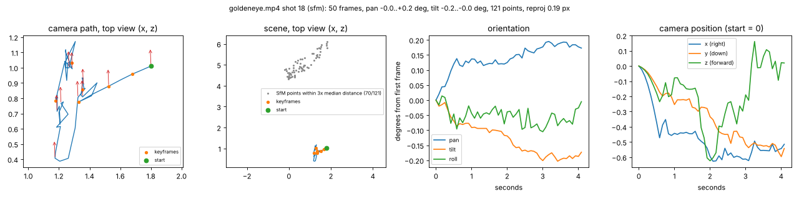
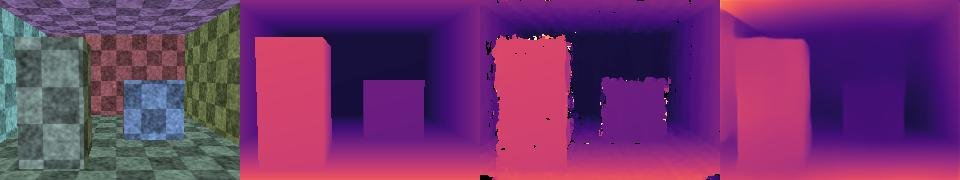
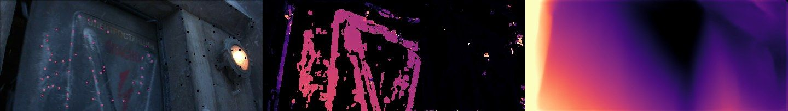
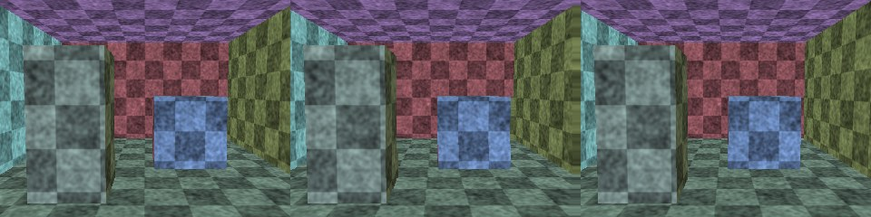
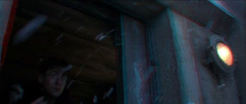
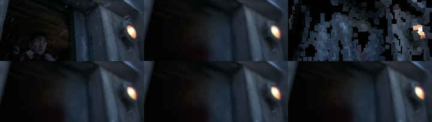

# Phase 5 — Camera path, 2D→3D, set fly-through (Weeks 14–17)

**Feature:** for any shot of any clip, CineScope recovers where the camera was
and where it pointed, frame by frame; reconstructs the set as a sparse point
cloud and dense depth maps; converts footage to stereo 3D; and turns a moving
shot into a set you can fly through with 3D Gaussian splatting. Everything
core is written here in NumPy / PyTorch; OpenCV, COLMAP and MiDaS are the
yardsticks.

```powershell
python p5_3d/camera_path.py trailers/goldeneye.mp4 --shot 18        # any clip, any shot
# -> outputs/goldeneye/camera_path_shot18.json + .png
python p5_3d/calibrate.py "data/calib/left*.jpg" --board 9x6        # Week 14
python p5_3d/sfm_eval.py --synthetic                                # Week 15, ground truth
python p5_3d/sfm_eval.py trailers/goldeneye.mp4 trailers/testvideo.mp4 trailers/Megamind.avi
python p5_3d/depth.py --synthetic                                   # Week 16
python p5_3d/depth.py trailers/goldeneye.mp4 --shot 18 8 17
python p5_3d/stereo3d.py --synthetic
python p5_3d/stereo3d.py trailers/goldeneye.mp4 --start 66.4 --seconds 4   # anaglyph + side-by-side mp4
python p5_3d/flythrough.py --synthetic --iters 400                           # Week 17
python p5_3d/flythrough.py trailers/goldeneye.mp4 --shot 18 --iters 1500
```

Shots come from Phase 0's detector (cached in `outputs/<clip>/shots.json`, made
on first use). MiDaS weights: `midas_v21_small_256.pt` in `data/weights/` (or
`$CINESCOPE_WEIGHTS`). Optional: `pip install pycolmap` for the COLMAP rows.



## Week 14 — calibration

| Built from scratch | Module | Checked against |
|---|---|---|
| Rodrigues exp/log, SO(3) right Jacobian, radial distortion (k1, k2) and its inverse | `cinescope/geometry/camera.py` | round trips, finite differences |
| Levenberg-Marquardt (Marquardt scaling, Nielsen damping update) | `cinescope/geometry/lm.py` | Rosenbrock, curve fit |
| Zhang: plane homographies (Phase 0 DLT) → closed-form K from the image of the absolute conic → extrinsics → linear k1, k2 → LM on reprojection error, block-sparse Jacobian | `cinescope/geometry/calib.py` | `cv2.calibrateCamera` |
| Self-calibration for film: focal prior from image size; vanishing points by RANSAC over line segments; f² = −(v1−p)·(v2−p) | `cinescope/geometry/selfcalib.py` | the chessboard calibration |

`python p5_3d/calibrate.py` on the 13 OpenCV sample images (640x480, 9x6 corners;
corner detection is OpenCV's for both methods, so only the calibration differs):

| | fx | fy | cx | cy | k1 | k2 | RMS px |
|---|---|---|---|---|---|---|---|
| ours, closed form (no distortion) | 545.62 | 546.99 | 353.20 | 233.29 | — | — | — |
| **ours, after LM** | **536.46** | **536.74** | **342.39** | **234.33** | **−0.2809** | **0.0784** | **0.4182** |
| `cv2.calibrateCamera`, same model (k1, k2) | 536.46 | 536.74 | 342.39 | 234.33 | −0.2809 | 0.0784 | 0.4182 |
| `cv2.calibrateCamera`, default model (k1–k3, p1, p2) | 536.07 | 536.02 | 342.37 | 235.54 | −0.2651 | −0.0467 | 0.4087 |

Identical to OpenCV with the same distortion model (to the printed digits); the
default model's three extra terms buy 0.01 px. The closed form, which ignores
distortion and minimises an algebraic error, is 1.7% off in focal length and
11 px off in cx — the LM step is not optional. One view (`left02.jpg`)
reprojects at 1.24 px against ~0.2 px for the others: its board is the most
oblique, where corner localisation is worst.

Self-calibration, scored against the calibrated fx = 536.5 (`results/calibration.json`):

| Fallback | f | error |
|---|---|---|
| size prior 1.2 · max(w, h) | 768 | 43% |
| vanishing points of the board's own rows/columns, per view (median of 12) | 576 | 7.4% |
| vanishing points from Hough segments of the whole image (10 of 13 views) | 595 | 11% (median) |

The prior is a last resort; vanishing points work when the scene has two
orthogonal sets of straight lines. These photos have a strong barrel
distortion (k1 = −0.28) that bends the "straight" lines, which is part of the
7% error. In the SfM below the focal length starts from the prior and bundle
adjustment refines it — which works only when the camera translates.

## Week 15 — two-view geometry, SfM, bundle adjustment

| Built from scratch | Module | Checked against |
|---|---|---|
| Normalised 8-point (F and E), Sampson distance, LO-RANSAC, E → four (R, t) + cheirality, LM refinement of (R, t) on Sampson error, multi-view DLT triangulation | `cinescope/geometry/twoview.py` | `findEssentialMat` (5-point), `recoverPose`, `triangulatePoints` |
| PnP: DLT on normalised coordinates + RANSAC + LM | `cinescope/geometry/pnp.py` | `solvePnPRansac` (EPnP) + `solvePnPRefineLM` |
| Bundle adjustment: analytic Jacobian blocks (points, axis-angle poses via the SO(3) right Jacobian, shared focal); our own Schur-complement LM with Huber IRLS; the same residuals/sparse Jacobian through `scipy.optimize.least_squares` for comparison | `cinescope/geometry/ba.py` | finite differences; scipy |
| Tracks: Phase 0 Harris + pyramidal LK, forward-backward check, replenishing | `cinescope/geometry/tracks.py` | |
| Incremental SfM over keyframes (keyframe selection, initial pair by inliers × parallax, PnP registration, robust triangulation, periodic BA, outlier filtering, PnP for every non-keyframe) | `cinescope/geometry/sfm.py` | OpenCV solvers in the same pipeline; COLMAP (pycolmap 4.2) |
| A synthetic film set with exact poses and depth: a ray-cast textured room with two boxes | `cinescope/geometry/synthetic.py` | |
| Camera-path export, rotation-only fallback (R = K⁻¹HK, zoom separated by polar decomposition) | `cinescope/geometry/campath.py`, `p5_3d/camera_path.py` | synthetic pan |

**Bundle adjustment, ours vs scipy** (2,000 points, 30 cameras, 0.5 px noise,
same residuals and Jacobian): the Schur-complement LM reaches the noise floor
(0.61 px, the same as starting from the truth) in 5 iterations / 1.2 s;
`least_squares` (TRF + LSMR) is still at 2.2 px after its 50-evaluation budget,
because its inexact inner solves crawl along the free global scale. Eliminating
the points first is the reason BA scales at all.

**Two-view pose on synthetic matches** (200 matches, 0.5 px noise, 30%
outliers, f = 500, 20 trials, median error):

| | rotation (deg) | translation direction (deg) |
|---|---|---|
| ours: 8-point LO-RANSAC | 0.69 | 5.67 |
| ours: + LM on Sampson error | **0.48** | 3.85 |
| OpenCV: 5-point RANSAC + recoverPose | 0.65 | **2.98** |

The 8-point algorithm ignores that E has five degrees of freedom; the
non-linear refinement recovers most of the gap. Plain RANSAC (before LO) often
stopped with a fraction of the true inliers (as few as 20 of 138): an 8-point
model from noisy points under-counts its own support, and the adaptive
iteration count then ends the search early.

**SfM on the synthetic set** (`results/sfm_synthetic.json`; 30 frames, 240x180,
LK tracks; poses compared after aligning the world frames; ATE as a fraction of
the path length):

| Move | ours (BA) reproj / rot err / ATE | ours, no BA | OpenCV solvers, no BA | focal from a wrong prior (true 216) |
|---|---|---|---|---|
| dolly | 0.19 px / 0.49° / 0.38% | 0.28 px / 0.47° / 0.49% | 0.29 px / 0.34° / 0.57% | 223 |
| push in | 0.20 px / 0.04° / 0.16% | 0.26 px / 0.06° / 0.27% | 0.27 px / 0.13° / 0.55% | 394 |
| orbit | 0.24 px / 0.22° / 0.17% | 0.35 px / 0.35° / 0.55% | 0.66 px / 1.01° / 6.0% | 218 |
| pan (rotation only) | refuses (no parallax) | refuses | "reconstructs" 152 points | "reconstructs" 197 points |

Bundle adjustment is what makes the long orbit consistent (OpenCV-without-BA
drifts to 6% ATE). Two lessons in the last rows: forward motion barely
constrains the focal length (394 vs 216 — expansion from the centre looks the
same at any focal length), and with a wrong focal length even a pure pan
appears to have parallax, so the "no parallax, refuse" test needs the
intrinsics to be roughly right.

**SfM on public clips** (`results/sfm_clips.json`). Shots chosen by rule, not
by hand: every shot ≥ 1.5 s that Phase 0's camera classifier did not call
static — 12 shots of `goldeneye`, `testvideo`, `Megamind`. 480 px wide, every
2nd frame, at most 60 frames. Focal length unknown (prior, refined by BA).

| | shots reconstructed | mean reprojection error (px) on the 3 shots all reconstruct | points / mean track length (same 3) |
|---|---|---|---|
| **ours** (LK tracks, our solvers, our BA) | 3 / 12 | **0.27** | 68–121 / 2.8–6.2 |
| ours without BA | 3 / 12 | 0.38 | |
| OpenCV solvers, no BA (same tracks) | 6 / 12 | 0.47 | |
| COLMAP 4.2 (SIFT, sequential matching, Ceres BA) | 10 / 12 | 0.68 | 388–1217 / 11.6–32.1 |

Read this table carefully: **a low reprojection error is not a good
reconstruction.** COLMAP registers far more frames and points, with tracks
5–10x longer — every observation of a 30-frame track must agree with one 3D
point, which a 3-frame track does trivially. Our pipeline is conservative: it
only uses keyframe observations, drops anything above 2 px, and refuses shots
without measurable parallax (initial pair median angle ≥ 1°). The shots it
refused and COLMAP "reconstructed" include the two zooms (#9, #15) and the
scroll of a map across a computer screen (#6), where COLMAP's focal length
comes out at 95 px — a degenerate solution with a small residual. Shot #8 is
also a screen graphic (a map); both ours and COLMAP (f = 3,493 px)
"reconstruct" it, ours as a single plane — geometrically consistent, but the
motion is the graphic's, not a camera's.
On `testvideo` (macro shots, shallow depth of field, slow slider moves)
nobody reconstructs anything; on the animated `Megamind` shots, our
initial-pair test refuses and COLMAP succeeds — the honest failure of this
phase: our tracks are short (LK loses points on fast motion and textureless
CG surfaces) and only Harris corners, where COLMAP matches SIFT across frames.

Parameters (thresholds, keyframe spacing) were set on the synthetic scenes
and while debugging on goldeneye shots 4, 6, 17 and 18 — so those four are not
clean test shots; `testvideo`, `Megamind` and goldeneye #8, #9, #15, #20 were
not looked at before the run.

**Camera paths.** `camera_path.py` exports per-frame R, t, centre, pan/tilt/roll
and (for SfM) the point cloud. On goldeneye shot 18 (camera cranes up past a
bunker wall) the path rises and drifts left while the orientation changes
by under 0.2° — a crane move, not a tilt, which a homography-based classifier
(Phase 0 said "handheld") cannot tell apart. When SfM refuses, the
rotation-only path is exported, with steps whose homography is not "rotation
+ zoom" (misfit > 5%, threshold from synthetic data) held, not trusted.

## Week 16 — depth and 2D→3D

| Built from scratch | Module | Checked against |
|---|---|---|
| Plane-sweep stereo: fronto-parallel planes uniform in inverse depth, plane-induced homographies, windowed ZNCC via integral images, best-half-of-sources occlusion handling, parabolic sub-plane refinement, texture/peak confidence | `cinescope/geometry/mvs.py` | true depth (synthetic) |
| Scale-invariant depth metrics: si-log RMSE, median-scaled abs-rel and δ<1.25, Spearman, affine fit of inverse depth | `cinescope/geometry/metrics.py` | |
| DIBR: disparity budget (% of width, screen plane), forward warp with z-buffer, background-side hole filling, anaglyph, side-by-side | `cinescope/geometry/dibr.py` | a true stereo pair (synthetic) |
| MiDaS v2.1 small wiring (network code vendored, EfficientNet-Lite3 from timm) | `cinescope/geometry/midas.py` | the official checkpoint loads with no missing keys |

**Synthetic room** (`results/depth_synthetic.json`; reference frame vs 4
neighbours, 64 planes; MiDaS given the oracle scale/shift fit to the true depth):

| | si-log | abs rel | δ < 1.25 | Spearman | coverage |
|---|---|---|---|---|---|
| plane sweep, dolly | **0.087** | **0.020** | **0.979** | **0.960** | 99% |
| MiDaS small, dolly | 0.162 | 0.143 | 0.862 | 0.867 | 100% |
| plane sweep, orbit | **0.126** | **0.031** | **0.961** | **0.923** | 97% |
| MiDaS small, orbit | 0.138 | 0.104 | 0.862 | 0.902 | 100% |

With known poses and texture everywhere, multi-view geometry wins by a wide
margin: MiDaS gets the layout right (near box, far wall) but bends planes.


*Frame · true depth · plane sweep (confident pixels) · MiDaS (fitted) — inverse depth, bright = near.*

**Goldeneye** (`results/depth_goldeneye.json`; reference = SfM points seen in
the middle keyframe, the only trusted depth there is):

| Shot | SfM points | plane sweep: Spearman / si-log / coverage | MiDaS: Spearman / si-log |
|---|---|---|---|
| #18 bunker wall, crane | 103 | **0.93** / **0.73** / 38% | 0.77 / 2.03 |
| #17 two people, handheld | 64 | 0.40 / **0.70** / 39% | **0.59** / 0.74 |
| #8 computer screen | 75 | — (all points on one plane: rank is noise) / 0.03 | — / 0.01 |

On the wall, where there is texture and parallax, the sweep agrees with SfM
(it shares its poses, so this is a consistency check, not independent proof);
it is confident on only ~40% of pixels — dark, flat and moving regions are
left empty rather than guessed. On the moving actors (#17) the multi-view
assumption (a static scene) breaks and the single-image network does better.
That is the argument for MiDaS in the 2D→3D converter: most film shots barely
move the camera, and people move.


*Goldeneye shot 18: keyframe with SfM points coloured by depth · plane sweep · MiDaS.*

**2D→3D conversion** (`stereo3d.py`): MiDaS inverse depth per frame →
disparity (2.5% of width for the nearest point, the 25th percentile of depth
on the screen plane, levels smoothed over time) → both eyes by forward
warping → anaglyph and side-by-side MP4. On the synthetic room, synthesising
the right view of a true stereo pair (baseline 0.15, up to 12 px disparity)
from the left view and the true depth:

| Right view | PSNR (dB) | PSNR in the disoccluded holes |
|---|---|---|
| no warp (left view as is) | 19.5 | |
| DIBR, holes filled from the foreground side | 32.4 | 18.2 |
| **DIBR, holes filled from the background side** | **33.6** | **21.7** |

On goldeneye (95 frames at 480 px): 1.6% of pixels are holes per eye; MiDaS
takes 3.1 s and DIBR 0.33 s per frame on a heavily shared CPU.


*Left view · right view synthesised by DIBR · true right view.*


*A red-cyan anaglyph frame from the converted goldeneye clip.*

## Week 17 — Gaussian splatting fly-through

| Built from scratch | Module | Checked against |
|---|---|---|
| 3D Gaussians (quaternion + log-scale covariance, logit opacity and colour), EWA projection with the perspective Jacobian, depth sort, 16x16 tiles with batched padded compositing, transmittance by log-cumsum, L1 + D-SSIM training with Adam, clone/split/prune densification | `cinescope/geometry/splat.py` | a dense (untiled) reference renderer (equal to 2e-7); float64 finite-difference gradients (to 1e-4) |
| Initialisation from SfM points + back-projected plane-sweep depth; novel camera path (sway + push beyond the real path); point-cloud baseline | `p5_3d/flythrough.py` | |

The official implementation and gsplat need CUDA; this runs on a CPU at
~1 s per iteration for a 160x120 image with ~2–10k Gaussians (shared machine).

Held-out frames are every 4th posed frame; they are never seen in training.
"Points" is the initial point cloud (MVS + SfM) rendered with a z-buffer,
using the point size that scores best on the *training* frames.

| Scene | Iters | Gaussians | Held-out PSNR splat | Held-out PSNR points | Novel view vs truth (splat / points) | s/iter |
|---|---|---|---|---|---|---|
| Synthetic room (true poses, 160x120) | 400 | 3322 | **27.57 dB** | 19.21 dB | 22.08 / 16.19 dB | 1.30 |
| goldeneye #18 (our SfM poses, 240x102) | 1500 | 6366 | **24.76 dB** | 17.39 dB | — (no ground truth) | 1.03 |
| goldeneye #18, same run stopped at 400 iters | 400 | 1958 | 23.36 dB | 17.39 dB | — | 0.81 |

On goldeneye #18 the first three held-out frames (1596–1612) score only
18.3–20.0 dB, which is no better than the points. In those frames an actor walks
in, and a static splat scene cannot represent motion. On the other nine
held-out frames the splat averages 26.4 dB. A longer synthetic run (1500 iters)
was abandoned because the machine was shared and it would not have finished
within the time limit.



*Top row: held-out frame, splat render, point render. Bottom row: three views
along the novel path (sideways sway and push-in beyond the real camera).*

## Interview questions

**Why does Zhang's method need at least three views of a plane?** Each
homography gives two linear constraints on the 5 unknowns of B = K⁻ᵀK⁻¹
(6 entries up to scale); three views give six. With zero skew assumed (one
more constraint), two views suffice in principle — but views must not be
parallel to each other, or the constraints repeat.

**Fundamental vs essential matrix?** F relates pixel coordinates of two
uncalibrated views (7 DoF, rank 2). E = K₂ᵀFK₁ relates normalised coordinates
of calibrated views: E = [t]ₓR has 5 DoF (rotation 3, translation direction 2;
scale is unobservable) and two equal singular values. From E you can read the
relative pose; from F only a projective reconstruction.

**Why four solutions from E, and how do you pick?** E's SVD gives two
rotations (UWVᵀ and UWᵀVᵀ) and the translation up to sign: four (R, t). Three
of them put the scene behind one or both cameras. Triangulate the matches with
each and keep the one with the most points at positive depth in both views
(the cheirality condition).

**What is the Schur complement trick in bundle adjustment?** The normal
equations have a camera block U, a point block V and a coupling W. Points
never interact with each other, so V is block-diagonal (3x3 per point) and
cheap to invert. Eliminate the points: (U − W V⁻¹ Wᵀ) δc = rhs is a small
dense system in the camera unknowns only; then back-substitute each point.
Millions of points cost little more than thousands.

**Why does monocular SfM have a scale ambiguity, and what fixes it?** Scaling
the whole scene and every camera translation by s leaves every image
unchanged. Only outside knowledge fixes it: a known object size, a stereo rig
baseline, an IMU, or a depth sensor. Film SfM stays in "scene units".

**When does SfM fail on film footage?** No translation (pan, tilt, zoom,
locked-off): no parallax, nothing to triangulate — Phase 0's homography
describes those shots exactly. Moving actors filling the frame (the scene is
not static). Planar scenes (a wall, a screen) are degenerate for the 8-point
algorithm. Unknown and changing focal length (zooms) — the self-calibration
fails exactly where the camera only rotates.

**Plane sweep vs a monocular network?** The sweep measures depth from
geometry: accurate where there is texture and baseline, empty elsewhere, and
it needs the camera poses. The network infers depth from appearance (learned
priors about rooms and people): dense, works on a single frame and on moving
people, but only up to scale and shift, and it bends flat surfaces.

**Why fill DIBR holes from the background?** A hole appears where a near
object moved and uncovered something the camera never saw — necessarily
something *behind* the object. Copying the background neighbour is a guess
from the right layer; copying the foreground smears the object's edge
outwards (the "rubber sheet" artefact): 21.7 vs 18.2 dB in the holes here.

**What makes Gaussian splatting fast compared to NeRF?** NeRF evaluates an MLP
at hundreds of samples along every ray. Splatting rasterises: each Gaussian is
projected once to a 2D ellipse, sorted once per tile, and alpha-composited —
the same "over" operator, but over a short sorted list of explicit primitives.
Gradients flow through the same compositing, so it optimises like NeRF and
renders like a rasteriser.

## Known limitations

- Our SfM refuses most film shots: short LK tracks and a strict parallax test.
  Next step: descriptor matching between keyframes (SIFT-like) to extend tracks
  across occlusions and fast motion, and a 5-point minimal solver.
- Non-keyframe poses come from PnP alone and jitter (visible in the camera-path
  plot); a final BA over all frames would smooth them.
- The splatting renderer is CPU-only and slow: low resolution, a few hundred
  iterations, degree-0 colour (no view-dependent effects).
- No ground-truth camera paths exist for the public clips; the synthetic set
  carries the accuracy claims.
