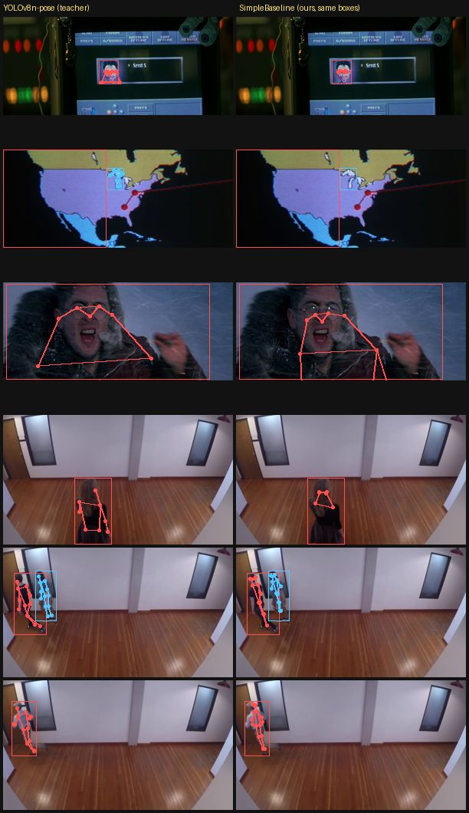
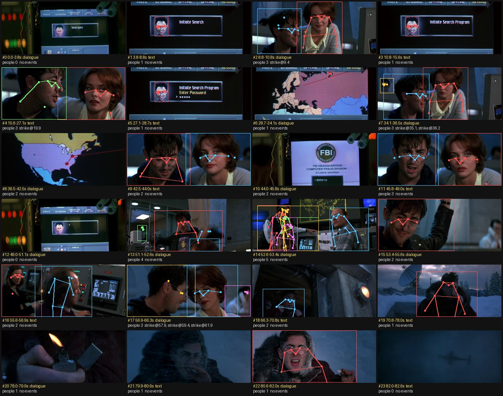

# Phase 6 — Pose, ViT, VideoMAE (Weeks 18–20)

**Feature:** for any clip, CineScope says per shot what kind of scene it is
(dialogue, action, establishing, crowd, text), how many people are in it and
how they move, and flags action events (strikes, falls, running) — with a
pose-overlay contact sheet.

```powershell
python p6_pose_video/breakdown.py trailers/goldeneye.mp4
# -> outputs/goldeneye/breakdown.json, outputs/goldeneye/breakdown.jpg
python p6_pose_video/breakdown.py clip.mp4 --pose yolo --scene clip     # library models only
```

Clips are looked up by path, or by name in `$CINESCOPE_CLIPS`, `trailers/` and
`data/clips/`. Weights come from `data/weights/` (or `$CINESCOPE_WEIGHTS`):
`yolov8n-pose.pt`, `yolov8n.pt`, `vit_b_32-quickgelu-laion400m_e32.pt` and the
ImageNet ResNet-18 `resnet18_a1_0-d63eafa0.pth` (timm's GitHub release:
`github.com/huggingface/pytorch-image-models/releases/download/v0.1-rsb-weights/resnet18_a1_0-d63eafa0.pth`).
The from-scratch checkpoints are made by the commands below (all on a CPU);
when one is missing, `breakdown.py` falls back to the library model and says so
in the JSON.

Every number below was measured on a shared 4-core CPU (2 threads per job,
other jobs running), so timings are pessimistic and only comparable within a
table.

## Week 18 — keypoints: OKS, keypoint AP, a top-down heatmap network

| Built | Module | Checked against |
|---|---|---|
| OKS, OKS matrix, COCO keypoint AP / AR (OKS in place of IoU in the Phase 2 evaluator) | `cinescope/pose/oks.py` (+ a `similarity` hook in `cinescope/detect/coco_eval.py`) | `pycocotools` `COCOeval(iouType="keypoints")` on random poses; hand-worked OKS cases |
| Gaussian heatmap targets, UDP coordinate mapping, sub-pixel decoding (quarter-offset and DARK Taylor), affine person crops | `cinescope/pose/heatmaps.py` | exact recovery of sub-cell peaks; crop → frame round trip |
| SimpleBaseline: ResNet-18 + 3 deconvs + 1×1 → 17 heatmaps, weighted MSE, flip test | `cinescope/pose/simplebaseline.py` | torchvision-compatible names (ImageNet weights load); flip consistency; learns a point |
| YOLOv8n-pose wrapper (library baseline and teacher) | `cinescope/pose/yolo.py` | — |
| Distillation data, training, evaluation, by-eye labelling tool | `p6_pose_video/build_pose_data.py`, `train_pose.py`, `eval_pose.py`, `label_pose.py` | — |

```powershell
python p6_pose_video/build_pose_data.py --out outputs/p6/pose_train.npz
python p6_pose_video/build_pose_data.py --clips goldeneye people-detection --fps 1 --keep-frames --out outputs/p6/pose_heldout.npz
python p6_pose_video/train_pose.py --data outputs/p6/pose_train.npz --minutes 30 --out outputs/p6/pose_sb.pt
python p6_pose_video/eval_pose.py --ckpt outputs/p6/pose_sb.pt          # -> results/pose.json, results/pose_examples.jpg
```

**How keypoint AP works.** OKS is to skeletons what IoU is to boxes:
OKS = mean over labelled keypoints of exp(−d² / (2 s² k²)), with d the pixel
error, s² the person's area and k a per-keypoint tolerance taken from how much
human annotators disagree (eyes are tight, hips loose). Keypoint AP is then the
box AP protocol unchanged — thresholds 0.50:0.05:0.95, 101-point interpolated
precision, 20 detections per image — with OKS in place of IoU. So the Phase 2
evaluator gained one hook (`similarity`) instead of being copied; the test checks
the result equals pycocotools on random data.

**Training (distillation).** No keypoint dataset can be downloaded here, so the
network learns from YOLOv8n-pose: the teacher labels every person (≥ 48 px
tall, ≥ 6 keypoints with confidence ≥ 0.5) in frames at 2 fps of nine public
training clips (vtest, classroom, face-demographics-walking,
head-pose-face-detection, one-by-one-person, person-bicycle-car, store-aisle,
worker-zone, car-detection) → 1 857 person crops; keypoints with teacher
confidence < 0.5 get zero loss weight. ResNet-18 initialised from ImageNet,
crops 128×96, heatmaps 32×24, scale/rotation/flip/colour augmentation, Adam with
cosine decay, 30 minutes = 1 254 batches of 32 (val loss 0.00127 → 0.00033).
goldeneye and people-detection are held out.

**Results** (`results/pose.json`):

Agreement with the teacher on held-out clips (teacher keypoints with
confidence ≥ 0.5 are the ground truth; the student runs on the teacher's
boxes, so only keypoint placement is scored):

| Held-out clip | People | Keypoint AP | AP50 | AP75 | mean best OKS |
|---|---|---|---|---|---|
| people-detection (static camera, full bodies — like the training clips) | 35 | 0.310 | 0.720 | 0.242 | 0.608 |
| goldeneye (film trailer: close-ups, motion blur, screens) | 122 | 0.020 | 0.071 | 0.001 | 0.271 |

Against keypoints labelled by eye on goldeneye (13 people, 62 keypoints,
12 frames; end to end, each model with its own person boxes):

| Model | Keypoint AP | AP50 | AP75 | AR | mean best OKS | ms / frame |
|---|---|---|---|---|---|---|
| YOLOv8n-pose (library) | **0.293** | **0.647** | 0.182 | 0.331 | **0.582** | 665 |
| SimpleBaseline, ours, on YOLOv8n boxes | 0.087 | 0.252 | 0.000 | 0.092 | 0.333 | 4 187 |



What the numbers say:

- **The student learnt the domain it saw.** On a static-camera clip of
  full-body pedestrians (the training clips' world) it reaches 0.72 AP50 of the
  teacher; on a film trailer it collapses (0.07 AP50). goldeneye is close-ups:
  a head and shoulders filling the box, which no training crop looked like, so
  the network still draws a full-body layout into the box (third row of the
  picture). Distillation copies the teacher only where the training data covers
  the inputs.
- **The teacher is not ground truth.** YOLOv8n-pose itself gets 0.29 AP on
  the by-eye labels; on these close-ups it misses or misplaces many face
  keypoints, so "teacher agreement" overstates real accuracy where the teacher
  is unsure.
- **Top-down costs more per person.** The student runs once per person after a
  separate detector; YOLOv8n-pose predicts every skeleton in one pass. On CPU the
  top-down pipeline was ~6× slower here.
- The by-eye set is small (13 people) and mostly faces and shoulders, so its
  numbers are indicative only. How it was made: `labels/goldeneye_pose.json`
  ("how" field) — person crops from the box-only detector, a 0–100 grid, read by
  eye before any pose model ran on the clip.

## Week 19 — pose tracks and action events

| Built | Module | Checked against |
|---|---|---|
| Synthetic stick-figure scenes with known events (fights, talk with gestures, chases, falls, walking, idling; camera pans, keypoint noise and drop-outs) | `cinescope/pose/synthetic.py` | bone lengths and geometry |
| Per-person tracks inside a shot: constant-velocity box prediction + Hungarian IoU matching | `cinescope/pose/track.py` | identities kept on crossing walkers and runners |
| Features (limb speeds relative to the hips, in body heights/s; inter-person distance; torso angle) and the strike / fall / run detector | `cinescope/pose/events.py` | pan invariance; events found in every scene type; no events in calm scenes |
| Threshold search and scoring | `p6_pose_video/eval_events.py` | — |

```powershell
python p6_pose_video/eval_events.py --tune     # grid search on synthetic seeds 0-199
python p6_pose_video/eval_events.py            # report on seeds 1000-1199 -> results/events_synthetic.json
```

Design notes:

- **Everything in body heights and seconds.** A punch by a figure 100 px
  tall and one 500 px tall is the same punch; the sampling rate does not
  matter.
- **Speeds relative to the hips.** A film camera pans and shakes; a pan moves
  wrist and hip alike, so measuring the wrist relative to its own hips cancels
  it. That is also why running is detected from the legs swinging (ankles
  relative to hips) and not from the body crossing the frame — a tracking shot
  hides that completely and a pan fakes it.
- **"Strike" is "fast limb that reaches someone".** 2-D pose cannot see
  contact (depth is unknown). The trap is conversation: people close together
  gesturing. Two guards help: the limb must end within 0.1 body heights of the
  other person's box, and the two people's hips must not be moving past each
  other (adding this test raised the tuning-set macro F1 from 0.898 to 0.937).

**Results on synthetic scenes** (200 tuning scenes, then 200 different test
scenes; `results/events_synthetic.json`):

| Event | Precision | Recall | F1 (test seeds) | F1 (tuning seeds) |
|---|---|---|---|---|
| strike | 0.905 | 0.860 | 0.882 | 0.822 |
| fall | 1.000 | 1.000 | 1.000 | 0.991 |
| run | 0.954 | 0.939 | 0.947 | 0.986 |
| **macro F1** | | | **0.943** | |

**On a real clip** (`results/events_goldeneye.json`). The goldeneye trailer
was labelled by eye at 2 frames/s before the detector ran on it
(`labels/goldeneye_events.json`): it is a dialogue sequence with **no**
strikes, falls or running, so it can only measure false alarms — with three
hard negatives listed (a fist pumped in celebration, an arm raised while
talking, a man climbing out of a hatch). `breakdown.py` at 8 pose frames/s:

| Pose source for the events | Events predicted (all "strike") | False alarms / minute | On the labelled hard negatives |
|---|---|---|---|
| SimpleBaseline (ours) on YOLOv8n boxes | 7 | 5.1 | 0 |
| YOLOv8n-pose (library) | 3 | 2.2 | 2 |

The clip has no true events, so recall could not be measured on footage: the
synthetic scores are the only recall numbers. Where the false strikes come
from (contact sheet below): **two faces side by side in a close two-shot**.
In a close-up the "body height" is a head, so a keypoint that jitters by a few
pixels between frames is a fast limb in body heights per second, and the other
person is always within reach. The student's keypoints jitter more on these
out-of-domain close-ups, so it fires more: all seven of its strikes are in
the four two-shots (#2, #4, #7, #17). Two of the library's three are on the
fist pump and the climbing man — real fast movements, but not strikes — and
one is in a two-shot.
Fixes to try: require a minimum visible body (shoulders *and* wrists) before
a strike can fire, and smooth keypoints over time before taking speeds.

`breakdown.py goldeneye` (default: our pose network + our VideoMAE scene model)
took 576 s for 82 s of video (559 s of it pose on 659 frames); the library
pair (`--pose yolo --scene clip`) took 357 s.



## Week 20 — ViT, VideoMAE and scene types

| Built | Module | Checked against |
|---|---|---|
| ViT: patch / tubelet embedding, multi-head self-attention written out, pre-norm blocks, [CLS] or mean pooling, learned or sin-cos positions | `cinescope/video/vit.py` | patch embedding = strided Conv2d, tubelet = Conv3d; attention = `F.scaled_dot_product_attention`; without positions the model cannot tell order |
| VideoMAE: tube masking (90%), encoder on visible tokens only, light decoder with [MASK] tokens, normalised-pixel loss on hidden tubelets | `cinescope/video/videomae.py` | the mask is the same in every frame; loss halves on a toy clip |
| Scene classes, OpenCLIP zero-shot teacher, shot accuracy | `cinescope/video/scenes.py` | — |
| Windows + teacher scores, training (pretrain / finetune / probe / image ViT), evaluation, labelling sheets | `p6_pose_video/build_scene_data.py`, `train_scenes.py`, `label_scenes.py` | — |

```powershell
python p6_pose_video/build_scene_data.py --out outputs/p6/scenes_train.npz
python p6_pose_video/build_scene_data.py --clips goldeneye Megamind --out outputs/p6/scenes_test.npz
python p6_pose_video/train_scenes.py pretrain --minutes 30                       # VideoMAE, unlabelled
python p6_pose_video/train_scenes.py finetune --init outputs/p6/videomae.pt --minutes 14
python p6_pose_video/train_scenes.py finetune --minutes 14                       # same model, random init
python p6_pose_video/train_scenes.py vit --minutes 12                            # image ViT on middle frames
python p6_pose_video/train_scenes.py probe --init outputs/p6/videomae.pt         # frozen encoder + logistic regression
python p6_pose_video/train_scenes.py probe
python p6_pose_video/train_scenes.py evaluate                                    # -> results/scenes.json
```

**Scene classes** (one per shot):

| Class | Definition |
|---|---|
| dialogue | a character scene: one to three people are the subject, no fast action (conversation, reaction shots, people walking or working) |
| action | fights, chases, explosions, vehicles at speed, fast physical motion |
| establishing | a place is the subject: landscapes, exteriors, cityscapes, wide interiors where people are absent or tiny |
| crowd | many people (about five or more) with no single subject |
| text | the frame is there to be read: title and credit cards, logos, screens, documents, maps, graphics filling the frame |

A shot that fits none (an insert of a lighter) is labelled `none` and left out
of accuracy.

**Data.** Shots (Phase 0 cuts) are split into windows of about 2 s; each
window stores 8 frames at 6 fps, centre-cropped to 7:4 and shrunk to 64×112.
Training windows: 440 from 13 public clips (the static-camera clips above,
testvideo, and two public test videos in `data/clips/`: a Big Buck Bunny
preview (animated) and `echo-hereweare` (kinetic typography, i.e. text)). Their labels come from **OpenCLIP
ViT-B-32-quickgelu zero-shot** (five prompts per class, mean of the logits of
three frames per window), used as soft targets — distillation. The teacher
called them dialogue 247, action 63, establishing 38, crowd 49, text 43.

**Test set.** Every shot of goldeneye (24) and Megamind (4), labelled by eye
from three-frames-per-shot sheets (`label_scenes.py`) **before any classifier
was run on them** (`labels/*_scenes.json`): 16 dialogue, 8 text, 3
establishing, 1 none. Neither clip is in any training set; no hyper-parameter
was chosen on them. Predictions are the mean of window probabilities per shot.

**Models** (all on CPU, 2 threads, shared machine):

- *VideoMAE pre-training*: a ViT-Tiny-like encoder at half depth (width 192,
  6 blocks, 3 heads; 4 frames → tubelets 2×8×8 → 224 tokens; fixed sin-cos
  positions) with a 2-block decoder, 90% tube masking, 30 minutes = 721 steps
  of 32 windows (loss 0.81 → 0.61, normalised pixels).
- *Fine-tuned*: that encoder + mean pool + linear head, all weights trained on
  the soft teacher labels for 14 minutes (76 steps of 32); the same model from
  random init, same budget, as the control.
- *Linear probe*: the encoder frozen, logistic regression on its mean-pooled
  features (teacher's hard labels); again pre-trained vs random init.
- *Image ViT*: the same width and depth on the middle frame only (8×8
  patches, [CLS] pooling), 12 minutes = 150 steps.

**Results — scene-type accuracy on the 27 hand-labelled shots**
(`results/scenes.json`):

| Model | Accuracy | dialogue (16) | text (8) | establishing (3) | agrees with teacher |
|---|---|---|---|---|---|
| OpenCLIP ViT-B/32 zero-shot (library, the teacher) | **0.852** | 16 | 7 | 0 | — |
| VideoMAE pre-trained → fine-tuned (ours) | 0.370 | 7 | 3 | 0 | 0.43 |
| video ViT, random init → fine-tuned (ours) | 0.222 | 3 | 3 | 0 | 0.29 |
| VideoMAE pre-trained → linear probe (ours) | 0.259 | 5 | 2 | 0 | 0.32 |
| random-init encoder → linear probe | 0.185 | 0 | 5 | 0 | 0.18 |
| image ViT ([CLS]) from scratch (ours) | 0.074 | 2 | 0 | 0 | 0.14 |
| *always "dialogue" (majority class, for reference)* | *0.593* | *16* | *0* | *0* | |

What the numbers say:

- **CLIP wins by far, and nothing from scratch beats the majority class.**
  The from-scratch models saw 440 tiny windows, most of them from a dozen
  static surveillance-style cameras; the test is a film trailer and an animated
  film. A transformer has almost no built-in prior about images, so with this
  little data it learns the training clips, not "dialogue". CLIP brings 400M
  image-text pairs. Honest summary: on a CPU in under an hour, a scene-type
  ViT from scratch does not work; the library does.
- **Self-supervised pre-training does help, consistently.** With the same
  budget and data, starting from the VideoMAE encoder beats random init both
  when fine-tuning (0.37 vs 0.22) and when probing (0.26 vs 0.19), and agrees
  with the teacher more. Masked-video reconstruction taught the encoder
  something about frames that the labels alone did not.
- **The video models beat the image ViT** (0.22–0.37 vs 0.07), but they also
  had different pooling and four frames of input, so this is not a clean test of
  "motion helps".
- **The teacher's own failures are inherited.** CLIP never calls goldeneye's
  establishing shots (a wall with a tiny figure, an aircraft in fog)
  establishing; its distilled students cannot learn a class the teacher does
  not give.
- The test set has no action or crowd shots (the trailer section used is a
  dialogue scene), so those classes are untested on real labels.

## Interview questions

1. **What is OKS and why does keypoint AP use it instead of IoU?** A
   Gaussian of the pixel error, scaled by the person's size and a per-keypoint
   tolerance learnt from annotator disagreement; averaged over labelled
   keypoints. Boxes say nothing about where the joints are; OKS makes AP
   reward joint placement with a tolerance that is fair across body sizes and
   across joints.
2. **Top-down vs bottom-up pose?** Top-down detects people, crops each and runs
   a single-person network (SimpleBaseline, HRNet): accurate, cost grows with
   the number of people, fails where the detector fails. Bottom-up finds all
   keypoints and groups them (OpenPose's part affinity fields), or one-stage
   models predict skeletons per anchor (YOLO-pose): constant cost.
3. **Why heatmaps rather than regressing (x, y)?** The heatmap keeps the
   convolution's spatial structure, gives a dense supervision signal and
   represents uncertainty and multiple candidates. The price is quantisation to
   the heatmap grid, which sub-pixel decoding (quarter offset, DARK) and the
   unbiased coordinate mapping (UDP) fix.
4. **Why did the distilled student do well on one held-out clip and badly on
   the other?** Its training crops were full-body people from static cameras; a
   trailer's close-ups were never in the training distribution. A student can
   only copy the teacher on inputs like the ones it was shown.
5. **How do you stop a camera pan from looking like running?** Measure limb
   motion relative to the person's own hips (or estimate and subtract the
   camera motion); a pan moves every point equally and cancels.
6. **Why does a ViT need position embeddings, and why a [CLS] token?**
   Self-attention is permutation-equivariant: without positions a shuffled
   image gives the same output. [CLS] is a slot with no patch of its own whose
   output summarises the image; mean pooling works too.
7. **Why does VideoMAE mask 90% of tubes, and why tubes?** Neighbouring frames
   are nearly identical, so per-frame random masks can be undone by copying
   from the next frame. Masking the same places in every frame forces the model
   to infer from other places; the high ratio keeps the task hard and makes the
   encoder 10× cheaper during pre-training.
8. **Why did the from-scratch transformers lose to zero-shot CLIP here?**
   ViTs have weak inductive biases and need far more data than a few hundred
   windows; CLIP saw 400M image-text pairs. Self-supervised pre-training helps
   only as far as the unlabelled data covers the test domain.
9. **Linear probe vs fine-tuning?** A probe freezes the encoder and fits a linear
   classifier: it measures what the representation already contains. Fine-tuning
   updates everything: usually better, but on tiny labelled sets it can overfit
   and hides how good the pre-training was.
