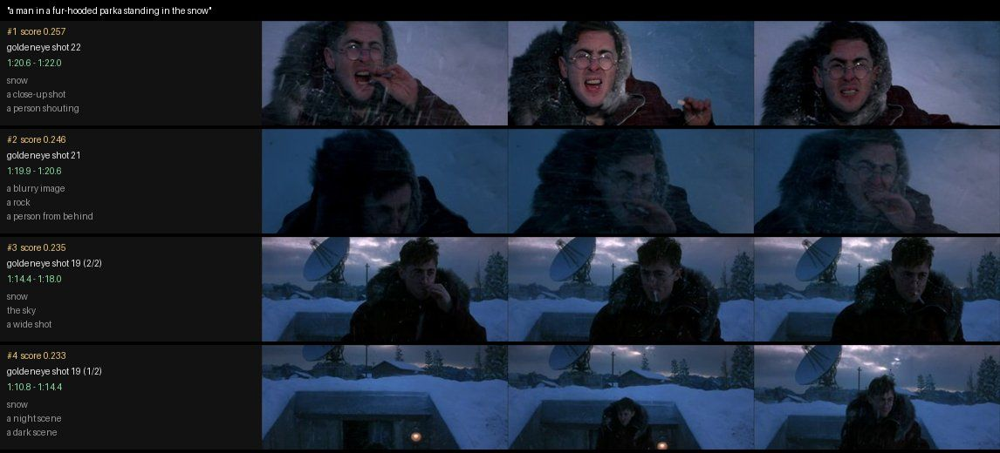

# Phase 8 — Scene search and chat with the movie (Weeks 23–24)

**Feature:** type what you remember — *"a man in a fur-hooded parka standing in the
snow"* — and CineScope returns the shots, with timestamps and a contact sheet. Ask
*"when does the car chase start?"* and it answers from the retrieved shots, citing
times, or says it cannot find one.

```powershell
python p8_search/search.py trailers/goldeneye.mp4 "the scene where a man walks away from an explosion"
# first query on a clip builds outputs/goldeneye/index/; later queries take ~0.1 s
# -> top-5 shots with timestamps, outputs/goldeneye/search/<query>.jpg
python p8_search/chat.py trailers/goldeneye.mp4 "when does the car chase start?"
python p8_search/chat.py trailers/goldeneye.mp4          # interactive
```

The encoder is pluggable (`--encoder`): `openclip` (default: ViT-B-32-quickgelu with the
local file `data/weights/vit_b_32-quickgelu-laion400m_e32.pt`; `CINESCOPE_WEIGHTS`
overrides the folder), `openclip:<model>:<pretrained>` for any open_clip model — e.g.
`openclip:ViT-B-16-SigLIP:webli` for SigLIP where HuggingFace is reachable — or
`scratch:<checkpoint>` for the encoder trained here.



*Top 4 of 27 segments of goldeneye.mp4 for "a man in a fur-hooded parka standing in the
snow" (exact search, open_clip). All four are the snow sequence; the labelled shots are
19, 21 and 22.*

## Week 23 — retrieval from scratch

| Built | Module | Checked against |
|---|---|---|
| Exact inner-product search (matrix product + argpartition top-k) | `cinescope/search/vecindex.py` | brute force; FAISS `IndexFlatIP` (identical ids) |
| k-means for codebooks: vectorised Lloyd + k-means++ (reused from `palette/kmeans.py`), spherical option, FAISS-style 256 points/centroid | `vecindex.py` | separated clusters recovered |
| IVF: inverted lists in CSR form, inner-product coarse quantiser, `nprobe` | `vecindex.py` | all lists probed = exact; FAISS `IndexIVFFlat` |
| Product quantisation; IVF-PQ on residuals with asymmetric distance (one LUT per query), optional exact re-ranking | `vecindex.py` | ADC score = ⟨q, centroid + decoded residual⟩ to 1e-4; FAISS `IndexIVFPQ` |
| CLIP-style dual encoder (4-stage CNN + 2-layer transformer), symmetric InfoNCE with learned temperature, multi-positive targets | `cinescope/search/dual_encoder.py` | loss falls; synthetic retrieval task below |
| Shot index: Phase 0 shots → segments ≤ 6 s → 3 key frames → embeddings → `outputs/<clip>/index/` | `cinescope/search/shotindex.py` | synthetic colour clip end to end |
| Recall@k / MRR with time-overlap relevance | `cinescope/search/metrics.py` | hand-worked cases |

`tests/test_week23.py` (21 tests) and `tests/test_week24.py` (10) run in ~10 s with no
weights or footage; the FAISS comparisons skip if FAISS is missing.

### How a query is answered

1. **Index once per clip.** Phase 0 (`cinescope/shots/pipeline.py`) finds the shots; a
   shot longer than 6 s is split into equal parts, so a 2-minute static take still
   answers "when". Each segment gets key frames at 1/6, 1/2 and 5/6 of its span. Wide
   frames are embedded as ⌈aspect⌉ square tiles covering the full width, averaged —
   CLIP's 224 px centre crop would drop 58 % of a 2.39:1 frame. The segment vector is the
   renormalised mean of its key frames. These choices were fixed before any evaluation.
2. **Search.** The query text is embedded; inner product with every segment vector
   (exact — a clip has tens to thousands of segments). The IVF/IVF-PQ indexes are for
   film-library scale and are benchmarked separately below.

### Vector indexes vs FAISS (`bench_ann.py`)

Recall is against exact search. Same `nlist`, `M = 32` sub-quantisers × 8 bits (40 bytes
per vector including the id, vs 2,048 for float32), same `nprobe`, 2 threads each, on a
CPU shared with other jobs (queries/s are indicative only).

**Real CLIP embeddings** — 2,747 open_clip tile embeddings from 17 public clips
(`caption_frames.py`), nlist 128; 500 held-out image tiles as queries, and 162 text
queries (the 50 labelled queries + the tag vocabulary):

| Queries | Index | nprobe | R@10 ours | R@10 FAISS | q/s ours | q/s FAISS |
|---|---|---|---|---|---|---|
| image | Flat | – | 1.000 | 1.000 | 8,668 | 5,774 |
| image | IVF-Flat | 1 / 4 | 0.874 / 0.989 | 0.859 / 0.995 | 4,733 / 4,061 | 27,493 / 24,190 |
| image | IVF-PQ | 1 / 16 | 0.627 / 0.688 | 0.663 / 0.717 | 3,886 / 2,001 | 17,201 / 7,690 |
| image | IVF-PQ + exact re-rank of 100 | 4 | 0.989 | – | 1,609 | – |
| **text** | IVF-Flat | 1 / 4 / 16 | 0.446 / 0.859 / 0.978 | 0.510 / 0.881 / 0.988 | 3,836 / 8,136 / 5,724 | 7,321 / 8,428 / 12,651 |
| **text** | IVF-PQ | 1 / 16 | 0.419 / 0.712 | 0.464 / 0.678 | 2,936 / 1,936 | 8,054 / 6,364 |

**Synthetic** — 100,000 unit vectors in 512-d from 2,000 Gaussian clusters, 1,000
queries, nlist 1,024:

| Index | nprobe | R@10 ours | R@10 FAISS | q/s ours | q/s FAISS | train s ours / FAISS |
|---|---|---|---|---|---|---|
| Flat | – | 1.000 | 1.000 | 235 | 316 | – |
| IVF-Flat | 1 / 8 | 1.000 / 1.000 | 0.999 / 1.000 | 3,892 / 710 | 17,183 / 3,860 | 304 / 18 |
| IVF-PQ | 1 / 32 | 0.371 / 0.371 | 0.368 / 0.369 | 2,410 / 992 | 14,516 / 4,352 | 454 / 66 |
| IVF-PQ + re-rank 100 | 1 | 1.000 | – | 2,797 | – | 504 |

What the numbers say:

- **Recall matches FAISS** to within a few points everywhere (sometimes above it: the
  ours/FAISS k-means and PQ training differ in detail). **Speed does not**: FAISS is up to
  7× faster at the same settings (typically 4–6×), because its list scans and LUT sums are SIMD C++ while ours
  loop over queries in Python. Exact NumPy search is as fast as FAISS's — both are one
  BLAS matrix product. Training is 7–17× slower (NumPy k-means on all points).
- **PQ alone caps recall** — at 0.69 (real) and 0.37 (synthetic) however many lists are
  probed: 32 bytes cannot tell apart neighbours that differ in fine detail, and the
  synthetic clusters' isotropic noise is the worst case for PQ. Re-ranking a shortlist of
  100 with the exact vectors restores it to 0.99–1.00; at film scale the full vectors then
  live on disk and only the shortlist is read.
- **Text queries are harder for IVF than image queries** (0.45 vs 0.87 at nprobe 1): CLIP
  text and image embeddings occupy different regions of the space (the *modality gap*), so
  a text query is far from every image centroid and the nearest centroid is a poor guide.
  Probe more lists for text search.
- **Two bugs the benchmark found.** The first version probed the lists with the nearest
  centroid in L2. For inner-product search the right order is largest ⟨q, c⟩ — a stored
  score is ⟨q, c⟩ + ⟨q, r⟩ — and FAISS's `IndexFlatIP` quantiser does that; with L2,
  text-query recall at nprobe 1 was 0.196 (now 0.446; FAISS 0.510). Second, k-means trained
  on at most 16k points regardless of `nlist` (16 per centroid at nlist 1,024) and assigned
  by inner product to un-normalised centroids, so a few large-norm centroids took huge
  lists: synthetic IVF recall stalled at 0.96 even at nprobe 32, at 90 queries/s. Spherical
  k-means and 256 training points per centroid fixed both (1.000).

### The from-scratch dual encoder (`train_dual_encoder.py`)

**Task 1: shapes and colours** — 32 px images of one or two shapes (3 shapes × 6 colours,
big/small, "left of"/"above") with generated captions; three colour–shape combinations
(purple triangle, yellow circle, green square) never appear in training. 543k parameters,
600 steps × 128 pairs, 6.4 min on one CPU thread.

| 1,000 test images | untrained | trained |
|---|---|---|
| text→image R@1 / R@5, seen combinations | 0.000 / 0.004 | 0.551 / 0.966 |
| text→image R@1 / R@5, **held-out** combinations | 0.011 / 0.042 | 0.844 / 0.906 |
| zero-shot 36-way "a {big/small} {colour} {shape}" | 0.021 | 0.832 (colour 1.000, shape 0.832) |
| word order: "A left of B" vs "B left of A", seen / held-out | 0.517 / 0.547 | 0.592 / 0.404 |

What it can do: compose attributes it has never seen together — "purple triangle" works
from "purple" and "triangle" seen separately. What it cannot do: **word order**. Telling
"red circle left of blue square" from its swap is at chance (0.59, and 0.40 for unseen
combinations) even though the text tower is a transformer with position embeddings:
contrastive training only needs whichever cue separates a caption from the *other captions
in the batch*, and in a random batch the swapped caption almost never occurs, so order is
never needed. That is the "bag-of-words" behaviour Yuksekgonul et al. (2023) measured in
CLIP itself; their fix is to put hard negatives (swapped captions) in the batch. Small
shapes are the main shape errors (a 5 px triangle vs circle).

Ablation: plain (diagonal-only) InfoNCE gives the same numbers (loss 0.5782 vs 0.5780).
With exact duplicate captions the text tower outputs identical vectors, and the two
losses are then mathematically equal; duplicates only set a loss floor (≈ log of the
group size), which is why the loss plateaus at 0.57 — see the module docstring.

**Task 2: video frames with automatic captions** — 1,694 frame tiles from eight public
clips *not* used in the search evaluation (intel-iot-devkit sample videos: cars, a store
aisle, a factory, a driver, bottles, bolts, fruit), each captioned by open_clip zero-shot
over the 80 COCO + 1,000 ImageNet class names, e.g. *"a photo of a manhole cover, a
overskirt and a tile roof"*. 788k parameters, 500 steps, 23 min. Validation on a held-out
clip: R@1 0.026, R@5 0.078 — it memorised its eight clips. On the search queries it is at
the random-ranking level (table below): 60 % of the queries contain no word it has ever
seen ("man", "woman", "walking", "snow" are not ImageNet or COCO classes), and the
pictures it learned from are warehouses and roads. That is the honest lesson of this
exercise: the method is the same as CLIP's; the 400 million captioned pairs are what make
CLIP work.

## Week 24 — chat with the movie (`chat.py`, `cinescope/search/rag.py`)

```
question ─► search query ─► retrieve segments ─► evidence ─► answer
"When does   "the car       CLIP cosine          times, tags,     template (default)
 the car      chase"        + BM25 over tags,     subtitles,       or an LLM given the
 chase start?"              subtitles, names     key frames       same evidence
```

- **Question → query:** strip "when does … start", "is there …", "how many times …"; the
  question type (when / yes-no / count / who / what) picks the answer template.
- **Hybrid retrieval:** CLIP similarity plus BM25 (from scratch) over each segment's
  words. Today those are zero-shot tags from a 112-concept film vocabulary; each document
  also has `subtitles: [{t0, t1, text}]` and `characters: [{name, seconds}]` fields, empty
  until Phase 7 (OCR) and Phase 3 (face timeline) fill them — `attach_subtitles`,
  `attach_characters`, or `chat.py --srt file.srt` now. A subtitle or name hit is evidence
  on its own: "when does he say 'for England'?" is a question no image embedding answers.
- **Saying "not found":** CLIP cosines are not probabilities — the best segment for "a car
  chase" in a clip without one still scores 0.21. Below 0.219 the answer says no segment
  matches (and still shows the closest one). The threshold was set on the dev clip
  (vtest.avi) only (`calibrate_chat.py`): halfway between its weakest present query
  (0.223) and its strongest absent one ("a car chase", 0.215 — parked cars). The
  *contrast* (best − median over segments) did not separate them on that static-camera
  clip, so it is reported but not used.
- **LLM optional:** with `ANTHROPIC_API_KEY` and `CINESCOPE_LLM_MODEL` (the model id) set
  and `pip install anthropic`, the evidence and one key frame per segment go to the model
  with the instruction to answer only from them and cite timestamps; any failure falls back
  to the template. No key was available here, so every answer below is the template.

Answers on public clips (`chat_examples.py` → `results/chat_examples.json`):

| Clip | Question | Answer (abridged) | Right? |
|---|---|---|---|
| goldeneye | When does the car chase start? | could not find it (best 0.211 < 0.219) | yes — there is none |
| goldeneye | Is there an explosion? | could not find it (0.199) | yes |
| goldeneye | Is there a plane? | yes: 0:55.6–0:56.9, 1:22.0–1:22.6 (best 1:22.0, shot 23) | best is right; 0:55.6 (control room) is not |
| goldeneye | When does someone light a cigarette? | first at 1:18.0 | half: the lighter at 1:18 is right, the cigarette lit at 1:06 (shot 18) is missed |
| goldeneye | What happens in the snow? | 1:20.6 (shot 22): snow, close-up, person shouting; also 1:10.8 | yes |
| goldeneye | Who is at the computer? | 0:55.6, shot 16; no names until Phase 3 | the right shot; "who" needs Phase 3 |
| people-detection | How many times is the room empty? | 4 stretches: 0:00–0:05, 0:11–0:22, 0:33–0:39, 0:44–0:50 | 4 is right (labels: 6–15, 21.5–29, 34–44, 47–50); spans are coarse |
| people-detection | When do three people walk in together? | could not find it — closest 0:27.6–0:33.1 | **wrong refusal**: that segment is right (0.212 < 0.219) |
| Megamind | Where are they having dinner? | could not find — closest: animated character, a glass of wine, a bar | wrong refusal |

The absolute threshold, set on four dev queries of one clip, is the weakest part: it is
encoder-specific and too strict for some true matches. A better rule needs labelled
absent/present questions on more clips (a calibration set, not the test set).

## Results — scene search on hand-written queries (`eval_search.py`)

50 queries on nine public clips written by eye from contact sheets **before** any search
ran (`labels/queries.json`, `labels/README.md`): 14 for goldeneye, 4 testvideo, 4
Megamind, 4 vtest (dev), and 24 on five single-shot clips of people walking, sitting
and turning their heads. The 46 test queries were scored once. *Per clip* searches the
query's own clip (what `search.py` does; 4–27 segments); *library* pools all 126
segments of the nine clips, so a query must also beat every other clip.

| Encoder | Index | Per-clip R@1 | R@5 | MRR | Library R@1 | R@5 | MRR |
|---|---|---|---|---|---|---|---|
| random ranking (expected) | – | 0.221 | 0.596 | 0.393 | 0.023 | 0.104 | 0.084 |
| open_clip ViT-B/32 | exact (ours) | **0.848** | **1.000** | **0.911** | **0.630** | **0.783** | **0.714** |
| open_clip ViT-B/32 | FAISS IndexFlatIP | 0.848 | 1.000 | 0.911 | 0.630 | 0.783 | 0.714 |
| open_clip ViT-B/32 | IVF-PQ (ours) | 0.543 | 0.630 | 0.579 | 0.370 | 0.457 | 0.424 |
| open_clip ViT-B/32 | FAISS IndexIVFPQ | 0.435 | 0.717 | 0.559 | 0.217 | 0.435 | 0.322 |
| open_clip ViT-B/32 | IVF-Flat (ours, diagnosis) | 0.652 | 0.674 | 0.660 | 0.543 | 0.587 | 0.576 |
| open_clip ViT-B/32 | IVF-PQ, every list probed (diagnosis) | 0.609 | 0.891 | 0.716 | 0.391 | 0.500 | 0.457 |
| dual encoder (ours, frames) | exact (ours) | 0.261 | 0.565 | 0.409 | 0.000 | 0.000 | 0.023 |
| dual encoder (ours, frames) | IVF-PQ (ours) | 0.065 | 0.109 | 0.080 | 0.022 | 0.022 | 0.027 |

Dev clip (vtest, 4 queries), open_clip exact: R@1 0.50, R@5 0.75. IVF/PQ settings, fixed
before the run: codebooks learned from the 1,910 training-clip tiles (never the evaluated
clips), nlist 32, M 16 × 8 bits, nprobe 8.

- **open_clip finds the shot** for 85 % of queries at rank 1 within a clip. Per-clip R@5
  is easy here (random gets 0.60: Megamind has 4 segments), so the library setting is the
  informative one: 0.78 R@5 among 126 segments.
- **Failures are fine-grained people.** Nine of the ten library misses beyond rank 5 are
  on the people clips (the tenth is testvideo's "a black screen", rank 6, beaten by dark
  frames of other clips): "a man in a light shirt and khaki trousers walking" (rank 68), "two people
  walking side by side" (34), "both people looking down" (22), "a man in a navy t-shirt"
  (15). CLIP ViT-B/32 sees "people in a room" and barely the clothes, the count or the
  head pose; every clip of people walking competes. The only goldeneye miss at rank 1 is
  "a man and a woman looking at a computer screen" (rank 3) — six shots fit and the
  computer is often off screen.
- **Approximate indexes hurt at this scale and buy nothing.** With 4–126 segments, IVF
  misses whatever sits in an unprobed list (IVF-Flat 0.674 vs 1.000 per clip — text queries
  and the modality gap again), and 16-byte PQ codes trained on other footage lose the fine
  ranking (every list probed: R@1 0.609 vs 0.848). Exact search over a 2-hour film's ~2,000
  segments is one 2,000 × 512 matrix product, about a millisecond; IVF-PQ is for
  libraries of millions of segments, and there it needs re-ranking (above). `search.py`
  defaults to exact.
- **The from-scratch encoder is at chance** (per-clip 0.565 R@5 vs random 0.596; library
  0.000 vs 0.104), for the reasons above: vocabulary and data, not the method.

## Design notes

- **Segments, not shots, are the unit.** Ground truth is stored as time intervals, and a
  retrieved segment counts as relevant when it overlaps an interval by half of the shorter
  of the two, so labels survive a different shot detector or segment length.
- **Hook points for later phases** are fields on every document (`subtitles`,
  `characters`, `tags`) plus `attach_*` helpers and `ShotIndex.save_docs()`; nothing in
  this phase imports Phase 3 or Phase 7 code.
- **An index is tied to its encoder**: `meta.json` records it and `search_text` refuses a
  query embedded by another model. open_clip indexes live in `outputs/<clip>/index/`,
  others in `outputs/<clip>/index_<encoder>/`.
- Timing on this shared 4-core CPU: indexing goldeneye (83 s, 27 segments, 81 key
  frames × 3 tiles) took 144 s, 86 s of it in CLIP; a query takes ~0.1 s (the text
  encoder). Phase 9 batches the image encoder on a GPU.
- `--index ivfpq` on one clip without a training corpus shrinks the codebooks to fit
  (27 segments → 1 list, 4 centroids per sub-space), which is as bad as it sounds; it is
  there to exercise the code path.

## Data

- Search evaluation clips: `trailers/` as in Phase 0 (PySceneDetect's goldeneye.mp4 and
  testvideo.mp4, OpenCV's Megamind.avi and vtest.avi, and five intel-iot-devkit
  sample videos).
- Training clips for the dual encoder and the ANN benchmark, disjoint from the above:
  `car-detection`, `person-bicycle-car-detection`, `store-aisle-detection`,
  `worker-zone-detection`, `fruit-and-vegetable-detection`, `bottle-detection`,
  `driver-action-recognition`, `bolt-detection` from
  `https://raw.githubusercontent.com/intel-iot-devkit/sample-videos/master/<name>.mp4`.

```bash
python p8_search/caption_frames.py data/train_clips/*.mp4 --out outputs/p8_train_frames.npz
python p8_search/caption_frames.py trailers/*.mp4 trailers/*.avi --fps 1 --out outputs/p8_eval_frames.npz
python p8_search/train_dual_encoder.py shapes --steps 600 --threads 1
python p8_search/train_dual_encoder.py frames --frames outputs/p8_train_frames.npz \
    --val-clip person-bicycle-car-detection --steps 500
python p8_search/bench_ann.py --real outputs/p8_train_frames.npz outputs/p8_eval_frames.npz --synthetic 100000
python p8_search/calibrate_chat.py trailers/vtest.avi
python p8_search/eval_search.py --trailers trailers --encoders openclip scratch:p8_search/checkpoints/dual_frames.pt
python p8_search/chat_examples.py --trailers trailers
```

## Interview questions

**Why does CLIP need such large batches?** InfoNCE classifies the right caption among the
batch's B captions; the batch *is* the set of negatives. With B = 32k, most negatives are
hard (similar scenes, similar wording), so the model must learn fine distinctions; with a
small batch, any coarse cue suffices. The word-order result above is that effect in
miniature: swapped captions never shared a batch, so order was never learned.

**What does the temperature do?** Cosines lie in [−1, 1]; a softmax over them is nearly
uniform, so gradients are weak. Dividing by τ ≈ 0.01–0.07 sharpens it. CLIP learns τ
(clamped so the scale ≤ 100); ours went from 0.070 to 0.053 on shapes.

**IVF vs HNSW vs PQ?** IVF partitions space with k-means and scans a few partitions:
simple, memory-light, easy to shard, recall controlled by nprobe. HNSW is a navigable
small-world graph: the best recall/speed for in-memory search, but ~1.5–2× the vectors'
memory in links and slow to build. PQ is orthogonal — it compresses vectors (64×
here) and scores them by table look-up; it is combined with IVF (IVF-PQ) or HNSW, and
followed by exact re-ranking when precision matters.

**Asymmetric vs symmetric distance in PQ?** Symmetric quantises the query too and reads
centroid-to-centroid distances from a precomputed table; asymmetric keeps the query exact
and builds a per-query table of query-subvector-to-centroid scores. Asymmetric costs one
small table per query and has strictly less quantisation error, so it is the default.

**Why retrieval-augmented generation for "chat with a movie"?** A film is ~170k frames;
no model reads them per question, and a model answering from memory invents scenes.
Retrieval bounds the evidence to a few segments with timestamps, so every claim can be
checked, and "I could not find it" becomes possible — the template answers here do exactly
that, and an LLM only rephrases the same evidence.

**What is the modality gap?** CLIP's image and text embeddings lie in two separated cones
of the shared space; a caption's nearest *image* is still far away in absolute terms
(cosines ~0.3, while image–image neighbours are ~0.9). Consequences measured here:
thresholds on raw cosine are encoder-specific, and IVF clusters built from images guide
text queries poorly (recall 0.45 vs 0.87 at nprobe 1).
