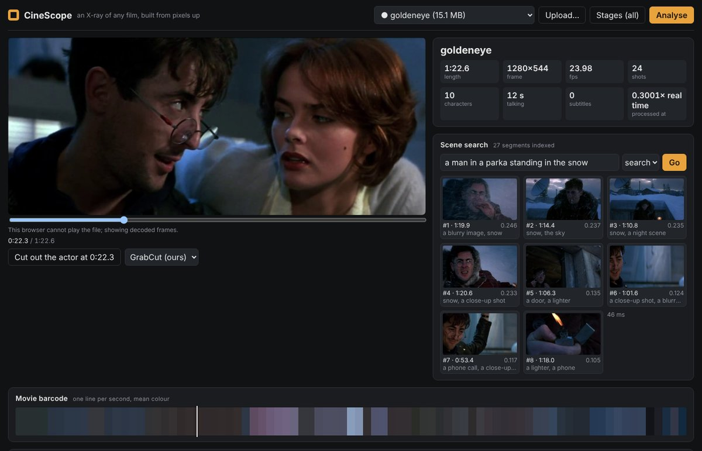

# Phase 9 — Whole-film pipeline and the web app (Weeks 25–26)

**Feature:** one command runs all of CineScope on any clip — shots, palettes and
barcode, camera moves, framing, faces, characters and who is talking, subtitles and
on-screen text, scene search, a camera path, people, poses, action events and scene
types (and, on request, actor cut-outs) — decoding the video once, caching every
stage, resuming after an interruption, and writing one `outputs/<clip>/report.json`.
A web app (FastAPI + React) runs jobs and shows the result.

```powershell
python -m cinescope.pipeline trailers/goldeneye.mp4 --backend onnx --workers 2
python -m cinescope.pipeline clip.mp4 --stages shots palette camera     # just Phase 0 (+ what it requires)
python -m cinescope.pipeline clip.mp4 --set faces.max_side=640 --set search.keyframes=2
python -m cinescope.pipeline --list                                       # the registered stages
# -> outputs/<clip>/report.json, outputs/<clip>/stages/<stage>/result.json + assets

uvicorn app.backend.main:app --port 8000      # then open http://localhost:8000 (see "Run the web app")
```


*goldeneye.mp4 in the web app (headless Chromium, `screenshot.py`) after one
`--backend onnx` run: summary; the shot strip with framing (CU/MS), camera-move, scene-type
and people chips and per-shot palettes; the movie barcode; the character timeline (blue:
on screen, red: talking); Phase 6's action-event and scene-type lanes; the text read from
the picture; the camera path of shot 17 (SfM); the per-stage timing. This Chromium build
cannot play H.264, so the player shows decoded frames.*



*Scene search: "a man in a parka standing in the snow" — the top four are the snow
sequence (Phase 8 index built by the pipeline, query encoded by ONNX CLIP, 58 ms).*

## Time to process a 2-hour film

**Before:** every phase's own tool, one after the other, as each phase shipped
(`bench_tools.py`: Phase 0 `analyse`, Phase 1 `FramingClassifier.label_shots`, Phase 3
`character_timeline` with SFace + Light-ASD's reference recipe, Phase 5 SfM on the longest
shot, Phase 6 `breakdown.py --pose yolo --scene clip`, Phase 7 subtitles + credits, Phase 8
`build_clip_index`; PyTorch). **After:** `python -m cinescope.pipeline --backend onnx
--workers 2` (`bench_pipeline.py`), the same features, every stage recomputed. Both on
the same 4-core Xeon @ 2.8 GHz, 2 intra-op threads, measured back to back at load
average ≈ 2 (`p9_production/results/tools_*.json`, `pipeline_*.json`, `film_2h.json`).

Extrapolation, with D the clip length, W the measured wall clock and F the part that
does not grow with the film (the camera path: SfM on one shot, Phase 5 / `campath`):

    T(2 h) = F + (7200 s / D) × (W − F)

Everything else is per frame, per shot or per face track and grows with running time.
Model loading and ONNX export (a few seconds, once) are left in W, so both columns are
slight overestimates.

**goldeneye.mp4** (82.6 s, 1280x544, 24 shots, dialogue):

| Feature | before: phase tools (s) | after: pipeline, PyTorch (s) | after: pipeline, ONNX (s) |
|---|---|---|---|
| Shots, palettes, camera moves (Phase 0) | 22.2 | 14.8 | 15.3 |
| Framing per shot (Phase 1) | 17.9 | 4.8 | 4.6 |
| Faces, who is talking, characters (Phase 3) | 328.3 | 194.8 | 158.7 |
| Camera path of one shot (Phase 5) | 46.4 | 72.5 | 68.8 |
| People, poses, events, scene types (Phase 6) | 93.9 | 18.9 | 20.9 |
| Subtitles and on-screen text (Phase 7) | 108.2 | 114.2 | 99.6 |
| Search index (Phase 8) | 49.4 | 15.8 | 18.3 |
| shared decoding pass | (inside each tool) | 34.2 | 35.0 |
| **wall clock** | **666.3** | **326.9** (2.0x) | **275.2** (**2.4x**) |
| **2-hour film, extrapolated** | **15.0 h** | **6.2 h** | **5.0 h** |

**testvideo.mp4** (24 s, the other Phase 0 test clip, no faces): 153.3 s → 66.5 s (2.3x);
a 2-hour film 11.0 h → 4.4 h.

How to read the per-feature rows: in the pipeline, the frame stages (shots, frames,
faces, subtitles, pose) run in parallel threads during one pass, so each stage's time
includes waiting for the CPU the others use and the rows do not sum to the wall clock.
Where the time went:

- **Not decoding the clip 13 times** — the tools read goldeneye 13 times in all: Phase 0
  once, Phase 1 once, Phase 3 three times (detection, its own Phase 0 pass, crops), Phase 5
  one shot, Phase 6 three times (its own Phase 0 pass, pose frames, scene windows), Phase 7
  twice (8 and 4 fps), Phase 8 twice (its own Phase 0 pass, key frames). The pipeline
  decodes once (35 s) and seeks once for the camera-path shot.
- **Reusing work across phases** — framing (3.9x) and Phase 6's scene types use the key
  frames and CLIP vectors the search stage already computed, instead of decoding and
  encoding frames again; Phase 6's poses get their frames from the same pass.
- **Light-ASD** batched and de-duplicated (11 → 6 chunkings, full chunks in one batch),
  then ONNX: the `speaking` stage takes 98 s in PyTorch and 63 s in ONNX Runtime.
- **ONNX Runtime** overall: 327 → 275 s (1.19x) on top of the pipeline; the models are a
  minority of the time, the rest is OpenCV/NumPy (face and text detection).
- **What did not get faster:** Phase 7 text detection (99.6 s: full-resolution frames at
  8 + 4 fps through a NumPy stroke detector — the largest stage now), and the camera path
  (SfM on one shot: 46 s as a tool, 69–73 s in both pipeline runs; not investigated —
  it is a fixed ~1 min per film either way).

**Load matters more than any optimisation.** The first measurement of both, taken while
two other jobs kept the load average at 11–15 (`results/loaded/`), gave 2,669 s for the
tools (Phase 3 alone 2,264 s) and 353 s for the pipeline (without the Phase 6 stages,
which did not exist yet). PyTorch's OpenMP threads spin-wait, and an oversubscribed CPU
punishes the PyTorch-heavy tools far more than the ONNX pipeline. The table above uses
only the back-to-back runs at low load.


## Week 25 — one pipeline instead of eight tools

| Built | Module | Checked against |
|---|---|---|
| Stage registry with one interface (`setup / begin / frame / end`), dependency resolution, cycle check | `cinescope/pipeline/core.py` | `tests/test_week25.py` (planning) |
| One decoding pass feeding every frame stage, each at its own width and rate; one resize per distinct width | `core.py` `decode_pass` | Phase 0's `analyse()` on a synthetic clip: identical shots, camera labels, palettes |
| Cache keyed by clip content hash + stage name, version, parameters, backend (model stages only) and the keys of the stages it requires | `core.py` `stage_key` | changing `palette.k` recomputes palette only; a second run decodes 0 frames |
| Resume: decode checkpoint (stage states + position) every 60 s of video; per-frame arrays on disk survive it | `core.py`, `cinescope/pipeline/store.py` | interrupted at frame 50 then resumed = straight run, byte for byte |
| Frame stages in their own threads (`--workers N`), per-shot loops in a process pool | `core.py` `_StageThread`, `stages.py` `_pool_map` | threaded run = serial run |
| Face crops cut during the single pass (Phase 3 decoded twice) | `cinescope/faces/align.py` `asd_patch / asd_from_patch` | Light-ASD crop from the stored patch vs. from the frame: mean abs diff < 1.5 grey levels, also for a smoothed (moved) box and at the frame edge |
| Light-ASD batched: each distinct chunk length once, weighted; full chunks as one batch | `cinescope/speaker/lightasd.py` | the reference recipe (11 chunkings, batch 1) to 1e-4 |
| Subtitle and credits readers as push sessions (one sample at a time) | `cinescope/ocr/subtitles.py`, `credits.py` | Phase 7 tests unchanged |
| ONNX export + ONNX Runtime for ResNet-18, face embedder, CLIP image/text towers, Light-ASD, CRNN; TensorRT provider behind `--backend tensorrt` | `cinescope/pipeline/accel.py`, `export_onnx.py` | PyTorch on a batch size (and length) different from the traced one: table below |
| One report per clip | `cinescope/pipeline/report.py` | `tests/test_week25.py`, the web app |

`tests/test_week25.py` (18 tests) runs in ~8 s on synthetic clips, no weights.

### The stages

| stage | phase | kind | reads | writes (`outputs/<clip>/stages/<name>/`) |
|---|---|---|---|---|
| `shots` | 0 | frame | 160 px, every frame | shot list, transitions, 96 px thumbnails of every frame (on disk, memory-mapped) |
| `palette` | 0 | post | shots | per-shot palettes, movie barcode |
| `camera` | 0 | post | shots | camera move per shot |
| `frames` | 1, 8 | frame | full, 2 fps + likely cuts | 640 px JPEG key frames |
| `faces` | 3 | frame | full, every frame | detections, tracks, face crops (Phase 3's format) |
| `speaking` | 3 | post | faces | per-track speaking scores (Light-ASD, or ours without its weights) |
| `characters` | 3 | post | faces, speaking | character timeline with talking intervals |
| `subtitles` | 7 | frame | full, 8 fps + 4 fps | subtitle cues (`.srt`), other on-screen text |
| `search` | 8 | post | shots, frames | Phase 8's shot index (`ShotIndex.load` works on it) |
| `framing` | 1 | post | shots, frames, search, faces | framing per shot: Phase 1's ResNet-18 if a checkpoint exists, else Phase 1's zero-shot teacher (CLIP prompts on the search stage's key-frame vectors + face size) |
| `campath` | 5 | post | shots, camera | camera path of the longest moving shot (SfM, or rotation-only) |
| `pose` | 6 | frame | 960 px, 4 fps | people, poses, action events per shot (YOLOv8n-pose) |
| `scenes` | 6 | post | search | scene type per shot (CLIP prompts on the stored key-frame vectors) |
| `cutouts` | 4 | post, opt-in | frames | RGBA cut-out of the largest person per shot (GrabCut + matting) |

*Frame* stages see frames during the single decoding pass; *post* stages run after it
on other stages' results and assets. Nothing decodes the video a second time except
`campath`, which seeks to its one shot (known only after the pass), and the Phase 3
audio track (read once with PyAV).

### Plugging in a stage (how Phases 4 and 6 went in)

Phases 4 and 6 were built on other branches while this one was; when they landed on
`main` each went in as one class in `stages.py`; nothing in the engine or the report
changed (the web app got two chips and a cut-out button, but would have shown them as
generic timelines without). The interface, written out for a Phase 4 *frame* stage (masks on
every sampled frame — the shape a video-segmentation stage takes):

```python
from cinescope.pipeline import Stage, Stream, register
from cinescope.pipeline.store import DiskArray

@register
class Masks(Stage):
    name = "masks"
    version = "1"                             # bump when the output changes: invalidates the cache
    requires = ("shots",)                     # ctx.results["shots"] is ready in end()
    streams = {"rgb": Stream(width=640, fps=2)}   # frames it wants during the one decoding pass
    defaults = {"method": "unet", "ckpt": None}   # parameters: part of the cache key; --set masks.method=yolo
    uses_backend = True                       # result depends on --backend (torch / onnx / tensorrt)
    transient = ("seg",)                      # not pickled into decode checkpoints
    default = False                           # opt-in: --stages masks

    def setup(self, ctx):                     # load models (again after a resume)
        self.seg = get_segmenter(self.params["method"], ctx.options.threads)
    def begin(self, ctx):                     # accumulators; big per-frame data on disk
        self.masks = DiskArray(ctx.stage_dir(self.name) / "masks.u8", (272, 640))
    def frame(self, ctx, views):
        f = views["rgb"]
        self.masks.append(self.seg(f.rgb, boxes_for(f))[0])
    def end(self, ctx) -> dict:               # JSON-able; files go in ctx.stage_dir(self.name)
        self.masks.close()
        return {"masks": "masks.u8", "per_shot": [...]}      # -> report shots[i]["masks"]
```

What is registered now:

- **`pose` (Phase 6, frame stage)**: `Stream(width=960, fps=4)`; frames are queued and
  sent to YOLOv8n-pose in batches of 8 (`state()` flushes the queue, so a checkpoint never
  holds unprocessed frames); Phase 6's own SimpleBaseline is used on the YOLO boxes when
  its checkpoint (`outputs/p6/pose_sb.pt`) exists. `end()` runs Phase 6's tracker and
  event detector per shot. `per_shot`: people counts, tracks, events; `timeline`: the
  strike / fall / run events.
- **`scenes` (Phase 6, post stage)**: `requires = ("search",)`. Phase 6's scene-type
  teacher is CLIP zero-shot prompts; the search stage has already embedded the key frames,
  so this stage runs only the 25 prompts through the text tower and scores the stored
  vectors — no decoding and no image-encoder pass (the same trick `framing` uses).
  Phase 6's fine-tuned VideoMAE scene model needs clips of frames and stays in
  `p6_pose_video/breakdown.py`.
- **`cutouts` (Phase 4, post stage, opt-in)**: the largest person in the middle key frame
  of each shot, GrabCut (our max-flow) + closed-form matting → RGBA PNG. `default = False`:
  it takes seconds per shot on a CPU, so it runs only with `--stages cutouts`. The web app
  also cuts out *any* frame on demand (`/api/clips/{clip}/cutout?t=`, "Cut out the actor"
  under the player), with GrabCut, the Phase 4 U-Net, YOLOv8n-seg or MobileSAM.
- **Report conventions** (`report.py`): a stage the report does not know by name has its
  result copied to `report["extra"][name]`; `result["per_shot"]` (one value per shot) is
  merged into `report["shots"][i][name]`; `result["timeline"]` (`[{t0, t1, label}]`) goes
  to `report["timelines"][name]`, which the web app draws as an extra lane. The shot strip
  shows `scenes` and `pose` as chips and `cutouts` as a thumbnail.
  `tests/test_week25.py::test_new_stage_plugs_in` registers a stage at test time and checks
  all three.
- Models go through `cinescope/pipeline/accel.py`: wrap the network with
  `OnnxModule(module, example, input_names, output_names, dynamic_axes, tag=...)` when
  `ctx.options.backend != "torch"`; it exports once (cached by weight fingerprint) and is a
  drop-in for `module(x)`.

### ONNX Runtime vs PyTorch (`export_onnx.py`)

Each model is exported with dynamic batch (and length / width) axes, then the same
random input — at a batch size and length *different* from the traced ones — goes
through PyTorch and ONNX Runtime 1.31. Times are the median of 5 runs after 2 warm-ups
(40 runs for the two small models, see "What broke"), 2 threads each, Intel Xeon @ 2.8 GHz,
PyTorch 2.14, on 4 CPUs shared with other jobs. `p9_production/results/onnx.json`.

| Model | max abs diff | min cosine | PyTorch b=1 (ms) | ONNX b=1 (ms) | speed-up | batch N | PyTorch b=N (ms) | ONNX b=N (ms) | speed-up |
|---|---|---|---|---|---|---|---|---|---|
| Phase 1 framing ResNet-18, 224x384 | 1.5e-07 | 1.000000 | 295.8 | 82.4 | **3.6x** | 16 | 2221 | 1235 | **1.8x** |
| Phase 3 face embedder (ours), 64x64 | 8.9e-08 | 1.000000 | 6.3 | 0.7 | **8.9x** | 24 | 76 | 25 | **3.0x** |
| Phase 8 CLIP ViT-B/32 image tower, 224x224 | 1.7e-06 | 1.000000 | 340.0 | 306.7 | **1.1x** | 16 | 2900 | 2127 | **1.4x** |
| Phase 8 CLIP text tower, 77 tokens | 1.2e-06 | 1.000000 | 421.4 | 102.0 | **4.1x** | 64 | 6221 | 5213 | **1.2x** |
| Phase 3 Light-ASD, 1 s = 25 crops + 100 MFCC steps | 1.7e-06 | 1.000000 | 2484.4 | 390.7 | **6.4x** | 8 | 8552 | 2751 | **3.1x** |
| Phase 7 CRNN line reader, 32x400 | 1.3e-05 | 1.000000 | 13.3 | 7.7 | **1.7x** | 16 | 156 | 46 | **3.4x** |

The numbers agree to float rounding everywhere (max abs difference ≤ 1.3e-5, cosine
1.000000). ONNX Runtime is faster on every model; the gain is largest where PyTorch's
per-layer dispatch dominates — batch 1, the GRU/LSTM models (Light-ASD 6.4x, which is
98 → 63 s for the `speaking` stage on goldeneye), small convnets — and
smallest on the CLIP image tower at batch 16 (1.4x), which is one big matmul workload in
both engines. The ResNet-18 uses timm's ImageNet weights with a random 5-class head (no
trained Phase 1 checkpoint ships with the repo); the speed does not depend on the weights.

**TensorRT.** `--backend tensorrt` asks ONNX Runtime for its TensorRT execution provider
(fp16, engine cache in `outputs/onnx/trt/`), then CUDA, then CPU, on the same exported
graphs. It needs an NVIDIA GPU and `onnxruntime-gpu` built with TensorRT. Measured on a
Kaggle T4 (`kaggle/run_all.py --only p9_tensorrt`: onnxruntime-gpu 1.22, TensorRT 10.9,
PyTorch 2.11 on CUDA 12.8; `results/tensorrt/`), median ms per call, each engine against
PyTorch on the same GPU:

| Model | TensorRT fp16 b=1 | PyTorch b=1 | TensorRT b=N | PyTorch b=N | ORT-CUDA b=N | max abs diff (fp16) |
|---|---|---|---|---|---|---|
| ResNet-18 (224x384) | 1.4 | 3.4 | 10.4 (N=16) | 22.7 | 28.1 | 6.2e-4 |
| CLIP image tower | 4.1 | 8.6 | 12.3 (N=16) | 57.9 | 56.0 | 1.1e-2 |
| CLIP text tower | 3.1 | 8.1 | 33.5 (N=64) | 150.8 | 159.5 | 1.1e-2 |
| Light-ASD (1 s chunk) | 3.9 | 16.3 | 23.6 (N=8) | 117.9 | 131.1 | 1.5e-3 |

Every row's minimum cosine against PyTorch is 1.000000. TensorRT is 2.1–4.7x PyTorch
on the GPU; plain ONNX Runtime on CUDA is no faster than PyTorch.

**The whole pipeline was slower with TensorRT, and why.** goldeneye on the same T4
machine: 383 s with `--backend onnx` (CPU), **2,140 s** with `--backend tensorrt`. The
`speaking` stage alone went from 54 s to 1,683 s. Light-ASD's input length changes with
every face track, and TensorRT builds a new engine for each new shape it meets (tens of
seconds each); the framing classifier (dynamic height and width) and the CLIP towers (a
new batch size per last batch) paid the same cost on a smaller scale. Models with a
dynamic axis other than the batch now run on CUDA under `--backend tensorrt`
(`OnnxModule` in `accel.py`), and engines are cached in `outputs/onnx/trt/`, so a batch
size seen once is not built again. This change has not yet been re-timed on a GPU.

ONNX Runtime also falls back to CPU silently when the GPU libraries do not match its
build: the first T4 run listed both GPU providers but ran every session on CPU.
`session()` now preloads PyTorch's CUDA libraries and warns when the requested provider
did not load.


## Week 26 — the web app

```
app/backend/main.py      FastAPI: jobs, progress, report and assets, frames, video, search, ask, camera path
app/frontend/            Vite + React (no other runtime dependency): source + package-lock.json
```

| Endpoint | What |
|---|---|
| `GET /api/clips`, `POST /api/clips/upload` | clips in `trailers/`, `data/clips/` (or `CINESCOPE_CLIPS`) and uploads; processed or not |
| `POST /api/jobs` `{clip, stages?, backend?, params?}`, `GET /api/jobs/{id}`, `POST /api/jobs/{id}/cancel` | runs the pipeline in a background thread, one job at a time; progress per stage; cancel stops at the next frame and the decode checkpoint lets the next job resume |
| `GET /api/clips/{clip}/report`, `/files/{path}` | `report.json` and every asset (thumbnails, barcode, face pictures, key frames); path traversal refused |
| `GET /api/clips/{clip}/frame?t=&width=` | one decoded frame as JPEG (thumbnail at any time; also the player's fallback) |
| `GET /api/clips/{clip}/video` | the file, with HTTP range requests, for `<video>` |
| `GET /api/clips/{clip}/search?q=`, `/ask?q=` | Phase 8 scene search and "ask the movie" over the clip's index |
| `GET /api/clips/{clip}/campath` | Phase 5 camera path |

The page: clip picker (analysed and not-yet-analysed clips grouped), upload by button or
by dropping a file anywhere (with upload progress; a name already taken gets `-2`, so an
upload never overwrites or hides another clip), stage and backend choice, and a progress
panel that lists each step (decoding, then every stage in run order) as done, running,
cached or waiting, with time left. A running job is picked up again after a reload. Then
the player (falls back to frames decoded on the server, with its own play button, when
the browser cannot play the codec, e.g. AVI); a summary; scene search and ask, with
example queries; the movie barcode; **how it was shot**: average and median shot length,
cuts per minute, the longest shot, the cutting rhythm (one bar per shot) and the share of
screen time per framing, camera move and scene type; the shot strip (filterable by those
labels; thumbnails decoded on demand when the `frames` stage has not run); the character
timeline with talking marks; subtitles and other on-screen text; the camera path as an
orbitable 3D polyline; extra timelines from new stages; the per-stage timing of the run.

Every time-based strip shows the time under the cursor and seeks on click (or with the
arrow keys when focused). Keyboard: Space/K play, ←/→ 5 s, J/L 10 s, `,`/`.` previous and
next shot, `/` search, `?` the list. The address bar always holds `?clip=…&t=…`, so a link
opens the same clip at the same moment ("Copy link to 1:23.4").

`tests/test_week26.py` (10 tests, ~2 s) drives the back end with FastAPI's `TestClient`:
a real job (cheap stages + search with a stand-in colour encoder) on a synthetic clip,
report and assets, frame and range requests, search ranking, caching of a second job,
the job's step plan and progress, upload (including name clashes), cancel, the Phase 6
scene stage through the report conventions, and a Phase 4 GrabCut cut-out through the
cut-out endpoint. CI installs FastAPI for them, runs the front end's unit tests
(`npm test`: Node's own test runner, no extra packages) and builds it (`npm run build`).

End to end: with the back end serving the public clips (`CINESCOPE_CLIPS=trailers`), a
job started through `POST /api/jobs` on `Megamind.avi` (11 s, never processed before) ran
all 13 default stages with the ONNX backend in 69 s and the page showed it (4 shots,
3 characters, scene types and pose lanes); the screenshots above are of goldeneye, whose
report came from the benchmark run. A cut-out at 0:20 of goldeneye took 1.1 s.

### Run the web app

PowerShell (Windows), from the repo root:

```powershell
pip install fastapi uvicorn python-multipart onnx onnxruntime
cd app\frontend; npm ci; npm run build; cd ..\..
$env:CINESCOPE_WEIGHTS = "$PWD\data\weights"    # default anyway
$env:OMP_NUM_THREADS = 4
uvicorn app.backend.main:app --port 8000
# open http://localhost:8000 ; pick a clip from trailers\ or upload one, press Analyse
```

bash:

```bash
pip install fastapi uvicorn python-multipart onnx onnxruntime
(cd app/frontend && npm ci && npm run build)
uvicorn app.backend.main:app --port 8000
```

Front-end development: `uvicorn ... --reload` and `cd app/frontend; npm run dev`
(http://localhost:5173, `/api` proxied to :8000).

Docker (CPU):

```powershell
docker build -t cinescope .
docker run --rm -p 8000:8000 -v "${PWD}\trailers:/clips" -v "${PWD}\data\weights:/weights" -v "${PWD}\outputs\app:/out" cinescope
```

The image builds the front end in a Node stage and installs CPU PyTorch; weights and
footage are mounted, never copied in (`python tools/fetch_assets.py` downloads both).
Its Python dependencies are `requirements.txt` + `requirements-full.txt`, the same files
`tools/run_everything.py` installs locally, so the image and a local run cannot drift
apart (the first version of the image lacked `ultralytics`, and the default `pose`
stage would have failed in it). CI builds the image on every push and smoke-tests it:
`/api/health` answers, and the pipeline runs Phase 0 on a public clip inside it.

Environment: `CINESCOPE_CLIPS` (clip folders, `;`-separated on Windows), `CINESCOPE_OUT`
(default `outputs/app`), `CINESCOPE_BACKEND` (`onnx` default, `torch`, `tensorrt`),
`CINESCOPE_WEIGHTS`, `CINESCOPE_ONNX_DIR` (exported models, default `outputs/onnx`).

## Design notes

- **Why one decoding pass.** Before Phase 9 a clip was decoded by every tool: Phase 0
  once, Phase 3 twice (detect, then cut crops from the finished tracks) plus a Phase 0
  pass for its cuts, Phase 6 once for poses and once for scene windows plus its own
  Phase 0 pass, Phase 7 twice (subtitles at 8 fps, credits at 4 fps), Phase 8 once
  more plus Phase 0 again. Here the
  video is decoded once and each frame stage declares the width and rate it wants. The
  catch is that some stages need frames chosen from results that exist only after the
  pass (key frames per shot, crops along smoothed tracks). Two answers: the `frames`
  stage keeps a 640 px JPEG every 0.5 s *plus the first frame after every large change*
  (a likely cut), so even a 0.2 s shot has a frame of its own; and the `faces` stage
  keeps, for every detection, a grey patch 1.5x the size of the Light-ASD crop, from
  which the crop along the *smoothed* box is cut afterwards (checked against cutting it
  from the frame: < 1.5 grey levels mean difference).
- **Memory stays flat.** A 2-hour film is ~170k frames. Per-frame data (96 px
  thumbnails, face crops) goes to append-only files read back through `np.memmap`
  (`store.py`), not lists in RAM; Phase 0 alone would have held ~2 GB of thumbnails.
- **The cache key includes the keys of the inputs.** Changing the shot detector's
  version changes the `shots` key, which changes every key built on it, so nothing stale
  survives; changing `palette.k` recomputes only the palette. The backend (torch / onnx)
  is in the key only for stages whose output comes from a network. The clip hash reads
  the size and the first and last MiB, not the whole file (hashing a 4 GB film would take
  longer than some stages).
- **Resume.** Each stage's state is its `__dict__` minus models (`transient`), pickled
  with the decoder position every 60 s of video. `DiskArray` truncates itself to the
  checkpointed length when unpickled, so frames written after the checkpoint are dropped
  and decoded again rather than duplicated. A stage that buffers (pose batches) flushes
  in `state()`.
- **Threads, not processes, for frame stages.** Each frame stage gets a thread and a
  bounded queue; YuNet (OpenCV DNN), ONNX Runtime, NumPy and PIL release the GIL, so the
  face detector and the text detector overlap. Per-shot loops with no shared state
  (palettes, camera moves) go to a spawned process pool that memory-maps the thumbnails
  instead of pickling them. Stage times in a threaded run overlap and do not sum to the
  wall clock.
- **ONNX on a CPU** helps most where PyTorch's per-op dispatch dominates — small inputs,
  recurrent or many small layers (Light-ASD, the CRNN, the face embedder at batch 1) —
  and least on large GEMM-bound models at large batch (the CLIP image tower: 1.1-1.4x),
  where both engines end up in the same BLAS kernels.
- **Light-ASD's own recipe was the biggest single cost.** Its test script scores every
  track with 11 chunkings (1, 1, 1, 2, 2, 2, 3, 3, 4, 5, 6 s) at batch 1. The network is
  deterministic, so the three 1 s chunkings give identical scores: running each distinct
  duration once and weighting it by its count gives the same mean with 6 chunkings, and
  the full-length chunks of one chunking go through as one batch.
- **What does not scale linearly.** `campath` reconstructs one shot whatever the film's
  length, so it is a fixed cost in the 2-hour formula; face clustering is quadratic in
  the number of tracks (thousands in a film: still seconds); the search index is linear
  in segments. Everything else is per frame or per shot.

## What broke, and what it taught

- **A clip with no faces crashed Phase 3** (`testvideo.mp4`: `reshape` of an empty
  embedding array) — in the tool and therefore in the pipeline. Phase 3 had only ever
  been run on clips with people. `timeline_from_crops` now returns an empty timeline,
  with a test.
- **Benchmarking on a shared machine.** The first ONNX table timed the face embedder at
  512 ms per face in PyTorch (5 repetitions, load average 14 from other jobs): PyTorch's
  OpenMP threads spin-wait, and with more runnable threads than cores a 6 ms call can take
  100x longer. Re-timed with 40 repetitions it is 6.3 ms. Medians of many short runs, and
  the load average written next to every timing, are what make these numbers usable.
- **Light-ASD's audio encoder does not export as is**: it applies `MaxPool3d` to 4-D
  tensors, which PyTorch reads as an unbatched 3-D volume and ONNX cannot express. On a
  copy, those pools become the equivalent `MaxPool2d` (same kernel and stride on the last
  axis); the exported graph matches PyTorch to 1.7e-6.
- **Dynamic axes must be checked, not assumed.** Every export is compared on a batch size
  (and for Light-ASD a sequence length, for the CRNN a line width) different from the one
  it was traced with; a silently frozen axis would fail there, not at export time.

## Known limitations

- TensorRT and CUDA were measured on a Kaggle T4, not on the development machine (no
  NVIDIA GPU); the fix that keeps variable-length models off TensorRT is not re-timed yet.
  The Docker image is built and smoke-tested in CI, not locally (no Docker daemon).
- Phase 1's framing classifier has no trained checkpoint in the repo (it is trained on
  the owner's videos), so the `framing` stage uses Phase 1's zero-shot teacher unless
  `p1_cnn/checkpoints/pretrained.pt` exists; the ResNet-18 ONNX numbers use timm's
  ImageNet weights with a random head (speed and agreement do not depend on what the
  weights learnt).
- The web app runs one job at a time and keeps jobs in memory (a restart forgets the
  list, not the results). There are no user accounts; it is meant to run locally.
- Browsers play H.264/WebM but not every file (AVI, MPEG-4 Part 2): the player then shows
  frames decoded by the back end, with a scrubber, not video.

## Interview questions

1. *Why decode once, and what does it cost you?* — Decoding and resizing a 1280x544 frame
   costs ~17 ms here; eight tools decoding the same film is minutes per hour of video, and
   each tool re-detects shots. The cost is that stages can no longer choose frames
   *after* seeing results; the answers are a key-frame store with cut-triggered frames
   and storing enough context (face patches) to cut crops later.
2. *How do you invalidate a cache correctly?* — Key = hash(content, stage name, version,
   parameters, backend if relevant, keys of the inputs). Including input keys makes
   invalidation transitive without tracking a dependency graph at run time.
3. *What has to be true for resume to give the same result?* — Stage state must be
   picklable apart from models; side-effect files must be truncatable to the checkpoint;
   sampling state (the next sample time per stream) must be saved; buffered work must be
   flushed. The test interrupts at frame 50 and compares against a straight run.
4. *When does ONNX Runtime beat PyTorch on a CPU, and when not?* — When dispatch overhead
   and unfused small ops dominate (batch 1, RNNs, small convnets): 2-9x here. Not much on
   large matmul-bound transformers at big batch (CLIP image tower 1.1-1.4x).
5. *How would you check an exported model?* — Same inputs through both engines at shapes
   different from the trace; report max abs difference and min cosine per row; keep the
   check in the export script so every re-export is checked.
6. *How do you extrapolate throughput to a 2-hour film honestly?* — Measure wall clock
   per stage on real clips, separate fixed costs (one-shot SfM, model loading) from costs
   proportional to length, state the formula, the machine and its load.
7. *Threads or processes for a Python video pipeline?* — Threads when the heavy work is
   in C/C++ libraries that release the GIL (OpenCV, ONNX Runtime, NumPy); processes for
   pure-Python loops, with data passed by path (memmap), not by pickling arrays.
8. *How do you add a new analysis without touching the engine?* — One registered class
   with declared inputs, streams and parameters, and report conventions (`per_shot`,
   `timeline`) that the report and UI render generically.

