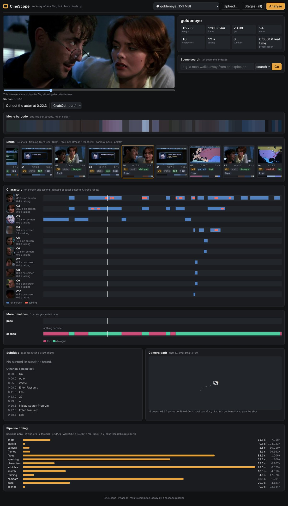

# Phase 9 — Whole-film pipeline and the web app (Weeks 25–26)

**Feature:** one command runs all of CineScope on any clip — shots, palettes and
barcode, camera moves, framing, faces, characters and who is talking, subtitles and
on-screen text, scene search, a camera path — decoding the video once, caching every
stage, resuming after an interruption, and writing one `outputs/<clip>/report.json`.
A web app (FastAPI + React) runs jobs and shows the result.

```powershell
python -m cinescope.pipeline trailers/goldeneye.mp4 --backend onnx --workers 2
python -m cinescope.pipeline clip.mp4 --stages shots palette camera     # just Phase 0 (+ what it requires)
python -m cinescope.pipeline clip.mp4 --set faces.max_side=640 --set search.keyframes=2
python -m cinescope.pipeline --list                                       # the registered stages
# -> outputs/<clip>/report.json, outputs/<clip>/stages/<stage>/result.json + assets

uvicorn app.backend.main:app --port 8000      # then open http://localhost:8000 (see "Run the web app")
```



*goldeneye.mp4 in the web app after one `--backend onnx` run: summary, shot strip with
framing and camera-move chips and per-shot palettes, the movie barcode, the character
timeline (blue: on screen, red: talking), the text read from the picture, the camera path
of shot 17 (SfM), and the per-stage timing.*

RESULTS_PLACEHOLDER

## Week 25 — one pipeline instead of eight tools

| Built | Module | Checked against |
|---|---|---|
| Stage registry with one interface (`setup / begin / frame / end`), dependency resolution, cycle check | `cinescope/pipeline/core.py` | `tests/test_week25.py` (planning) |
| One decoding pass feeding every frame stage, each at its own width and rate; one resize per distinct width | `core.py` `decode_pass` | Phase 0's `analyse()` on a synthetic clip: identical shots, camera labels, palettes |
| Cache keyed by clip content hash + stage name, version, parameters, backend (model stages only) and the keys of the stages it requires | `core.py` `stage_key` | changing `palette.k` recomputes palette only; a second run decodes 0 frames |
| Resume: decode checkpoint (stage states + position) every 60 s of video; per-frame arrays on disk survive it | `core.py`, `cinescope/pipeline/store.py` | interrupted at frame 50 then resumed = straight run, byte for byte |
| Frame stages in their own threads (`--workers N`), per-shot loops in a process pool | `core.py` `_StageThread`, `stages.py` `_pool_map` | threaded run = serial run |
| Face crops cut during the single pass (Phase 3 decoded twice) | `cinescope/faces/align.py` `asd_patch / asd_from_patch` | Light-ASD crop from the stored patch vs. from the frame: mean abs diff < 1.5 grey levels, also for a smoothed (moved) box and at the frame edge |
| Light-ASD batched: each distinct chunk length once, weighted; full chunks as one batch | `cinescope/speaker/lightasd.py` | the reference recipe (11 chunkings, batch 1) to 1e-4 |
| Subtitle and credits readers as push sessions (one sample at a time) | `cinescope/ocr/subtitles.py`, `credits.py` | Phase 7 tests unchanged |
| ONNX export + ONNX Runtime for ResNet-18, face embedder, CLIP image/text towers, Light-ASD, CRNN; TensorRT provider behind `--backend tensorrt` | `cinescope/pipeline/accel.py`, `export_onnx.py` | PyTorch on a batch size (and length) different from the traced one: table below |
| One report per clip | `cinescope/pipeline/report.py` | `tests/test_week25.py`, the web app |

`tests/test_week25.py` (16 tests) runs in ~15 s on synthetic clips, no weights.

### The stages

| stage | phase | kind | reads | writes (`outputs/<clip>/stages/<name>/`) |
|---|---|---|---|---|
| `shots` | 0 | frame | 160 px, every frame | shot list, transitions, 96 px thumbnails of every frame (on disk, memory-mapped) |
| `palette` | 0 | post | shots | per-shot palettes, movie barcode |
| `camera` | 0 | post | shots | camera move per shot |
| `frames` | 1, 8 | frame | full, 2 fps + likely cuts | 640 px JPEG key frames |
| `faces` | 3 | frame | full, every frame | detections, tracks, face crops (Phase 3's format) |
| `speaking` | 3 | post | faces | per-track speaking scores (Light-ASD, or ours without its weights) |
| `characters` | 3 | post | faces, speaking | character timeline with talking intervals |
| `subtitles` | 7 | frame | full, 8 fps + 4 fps | subtitle cues (`.srt`), other on-screen text |
| `search` | 8 | post | shots, frames | Phase 8's shot index (`ShotIndex.load` works on it) |
| `framing` | 1 | post | shots, frames, search, faces | framing per shot: Phase 1's ResNet-18 if a checkpoint exists, else Phase 1's zero-shot teacher (CLIP prompts on the search stage's key-frame vectors + face size) |
| `campath` | 5 | post | shots, camera | camera path of the longest moving shot (SfM, or rotation-only) |

*Frame* stages see frames during the single decoding pass; *post* stages run after it
on other stages' results and assets. Nothing decodes the video a second time except
`campath`, which seeks to its one shot (known only after the pass), and the Phase 3
audio track (read once with PyAV).

### Plugging in a new stage (Phase 4 segmentation, Phase 6 pose and scene types)

Phases 4 and 6 are being built on other branches. Each plugs in as one class in its
own module, registered on import; nothing in the engine, the report or the web app
changes. The interface:

```python
from cinescope.pipeline import Stage, Stream, register
from cinescope.pipeline.store import DiskArray

@register
class Cutouts(Stage):                         # Phase 4: subject masks per shot
    name = "cutouts"
    version = "1"                             # bump when the output changes: invalidates the cache
    requires = ("shots",)                     # ctx.results["shots"] is ready in end()
    streams = {"rgb": Stream(width=640, fps=2)}   # frames it wants during the one decoding pass
    defaults = {"model": "unet", "ckpt": None}    # parameters: part of the cache key, --set cutouts.model=sam
    uses_backend = True                       # result depends on --backend (torch / onnx / tensorrt)
    transient = ("net",)                      # not pickled into decode checkpoints

    def setup(self, ctx):                     # load models (again after a resume)
        self.net = load_segmenter(self.params["model"], self.params["ckpt"])
    def begin(self, ctx):                     # accumulators; big per-frame data on disk
        self.masks = DiskArray(ctx.stage_dir(self.name) / "masks.u8", (272, 640))
        self.times = []
    def frame(self, ctx, views):
        f = views["rgb"]
        self.masks.append(self.net(f.rgb))
        self.times.append(f.t)
    def end(self, ctx) -> dict:               # JSON-able; files go in ctx.stage_dir(self.name)
        self.masks.close()
        shots = ctx.results["shots"]["shots"]
        return {"masks": "masks.u8", "n": len(self.times),
                "per_shot": [subject_area(self, s) for s in shots]}       # -> report shots[i]["cutouts"]
```

- **Phase 4 (`cutouts`)**: a frame stage as above. Masks of a film do not fit in memory:
  append them to a `DiskArray` (memory-mapped; checkpoint-safe — it truncates itself to
  the last checkpoint on resume). `per_shot` puts one value per shot into the report's
  shot list.
- **Phase 6 pose (`pose`)**: a frame stage, `streams = {"full": Stream(None, fps=4)}`,
  `requires = ("faces",)` if it wants to attach skeletons to face tracks; keypoints to a
  `DiskArray`, `timeline` = spans of detected actions.
- **Phase 6 scene types (`scenes`)**: a *post* stage with `requires = ("search",)`: it
  reads the key-frame CLIP vectors the search stage already computed
  (`ShotIndex.load(ctx.out / "stages/search/index").kf_vectors`), so it costs no decoding
  and no image encoder pass — the same trick `framing` uses. Return
  `{"timeline": [{"t0", "t1", "label"}], "per_shot": [...]}`.
- **Report conventions** (`report.py`): a stage the report does not know by name has its
  result copied to `report["extra"][name]`; `result["per_shot"]` (one value per shot) is
  merged into `report["shots"][i][name]`; `result["timeline"]` goes to
  `report["timelines"][name]`, which the web app draws as an extra labelled lane with no
  front-end change. `tests/test_week25.py::test_new_stage_plugs_in` registers such a stage.
- Models go through `cinescope/pipeline/accel.py`: wrap the network with
  `OnnxModule(module, example, input_names, output_names, dynamic_axes, tag=...)` when
  `ctx.options.backend != "torch"`; it exports once (cached by weight fingerprint) and is a
  drop-in for `module(x)`.
- To make the stage run by default, import its module in `cinescope/pipeline/stages.py`
  (or set `default = False` on the class to make it opt-in with `--stages`).

ONNX_PLACEHOLDER

## Week 26 — the web app

```
app/backend/main.py      FastAPI: jobs, progress, report and assets, frames, video, search, ask, camera path
app/frontend/            Vite + React (no other runtime dependency): source + package-lock.json
```

| Endpoint | What |
|---|---|
| `GET /api/clips`, `POST /api/clips/upload` | clips in `trailers/`, `data/clips/` (or `CINESCOPE_CLIPS`) and uploads; processed or not |
| `POST /api/jobs` `{clip, stages?, backend?, params?}`, `GET /api/jobs/{id}`, `POST /api/jobs/{id}/cancel` | runs the pipeline in a background thread, one job at a time; progress per stage; cancel stops at the next frame and the decode checkpoint lets the next job resume |
| `GET /api/clips/{clip}/report`, `/files/{path}` | `report.json` and every asset (thumbnails, barcode, face pictures, key frames); path traversal refused |
| `GET /api/clips/{clip}/frame?t=&width=` | one decoded frame as JPEG (thumbnail at any time; also the player's fallback) |
| `GET /api/clips/{clip}/video` | the file, with HTTP range requests, for `<video>` |
| `GET /api/clips/{clip}/search?q=`, `/ask?q=` | Phase 8 scene search and "ask the movie" over the clip's index |
| `GET /api/clips/{clip}/campath` | Phase 5 camera path |

The page: clip picker / upload / stage and backend choice / progress bar; the player
(falls back to decoded frames when the browser cannot play the codec — e.g. AVI); a
summary; scene search and ask; the movie barcode; the shot strip (thumbnail, framing
chip, camera-move chip, palette, scrolls with the playhead); the character timeline
with talking marks; subtitles and other on-screen text; the camera path as an orbitable
3D polyline with the current camera's frustum; extra timelines from new stages; the
per-stage timing of the run. Every time-based element seeks the player on click.

`tests/test_week26.py` (7 tests, ~3 s) drives the back end with FastAPI's `TestClient`:
a real job (cheap stages + search with a stand-in colour encoder) on a synthetic clip,
report and assets, frame and range requests, search ranking, caching of a second job,
upload, cancel. It skips if FastAPI is not installed (CI installs only the core
requirements); CI builds the front end (`npm ci && npm run build`).

### Run the web app

PowerShell (Windows), from the repo root:

```powershell
pip install fastapi uvicorn python-multipart onnx onnxruntime
cd app\frontend; npm ci; npm run build; cd ..\..
$env:CINESCOPE_WEIGHTS = "$PWD\data\weights"    # default anyway
$env:OMP_NUM_THREADS = 4
uvicorn app.backend.main:app --port 8000
# open http://localhost:8000 ; pick a clip from trailers\ or upload one, press Analyse
```

bash:

```bash
pip install fastapi uvicorn python-multipart onnx onnxruntime
(cd app/frontend && npm ci && npm run build)
uvicorn app.backend.main:app --port 8000
```

Front-end development: `uvicorn ... --reload` and `cd app/frontend; npm run dev`
(http://localhost:5173, `/api` proxied to :8000).

Docker (CPU):

```powershell
docker build -t cinescope .
docker run --rm -p 8000:8000 -v "${PWD}\trailers:/clips" -v "${PWD}\data\weights:/weights" -v "${PWD}\outputs\app:/out" cinescope
```

The image builds the front end in a Node stage and installs CPU PyTorch; weights and
footage are mounted, never copied in. *The Dockerfile was written but not built here —
the development machine has no Docker daemon.*

Environment: `CINESCOPE_CLIPS` (clip folders, `;`-separated on Windows), `CINESCOPE_OUT`
(default `outputs/app`), `CINESCOPE_BACKEND` (`onnx` default, `torch`, `tensorrt`),
`CINESCOPE_WEIGHTS`, `CINESCOPE_ONNX_DIR` (exported models, default `outputs/onnx`).

DESIGN_PLACEHOLDER
